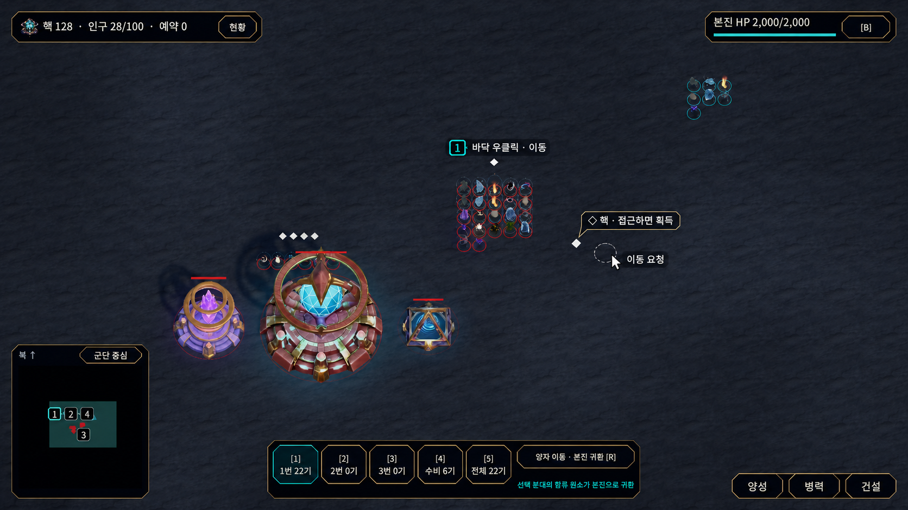
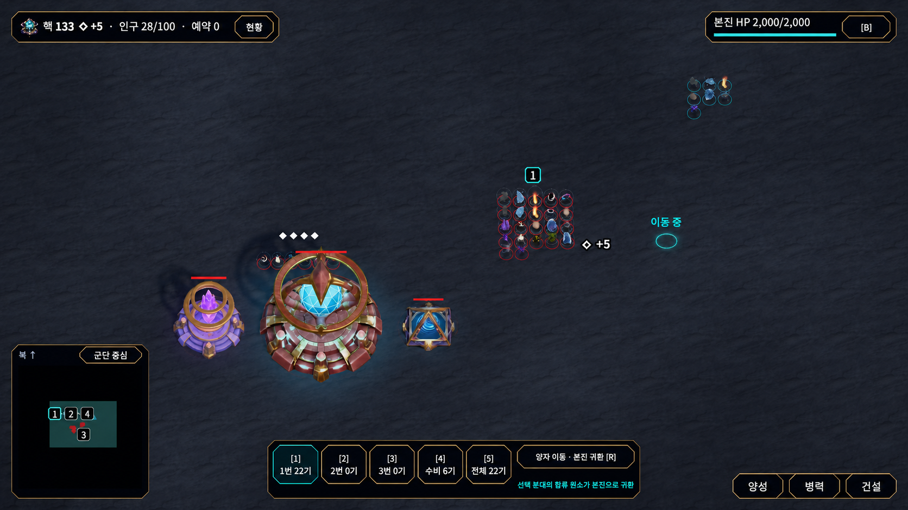
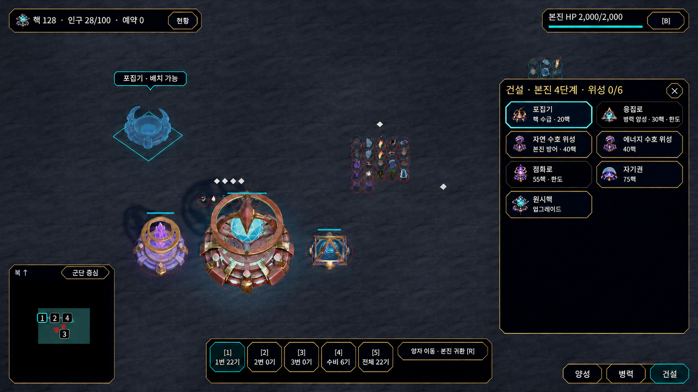
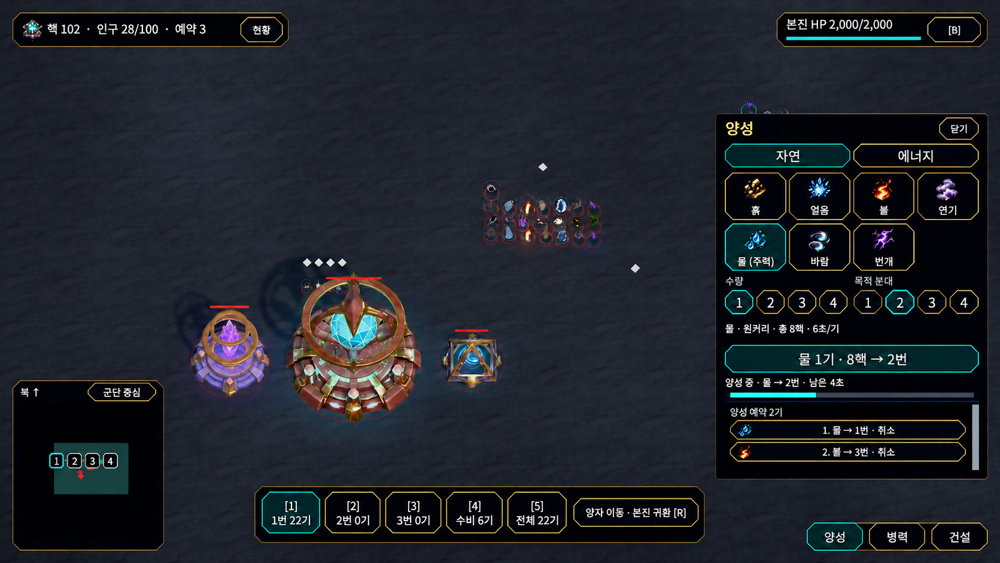
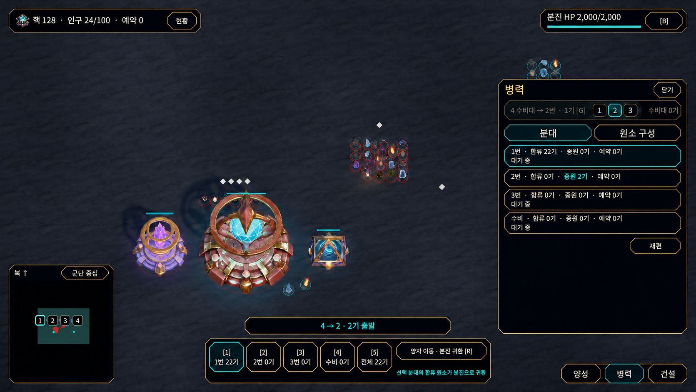
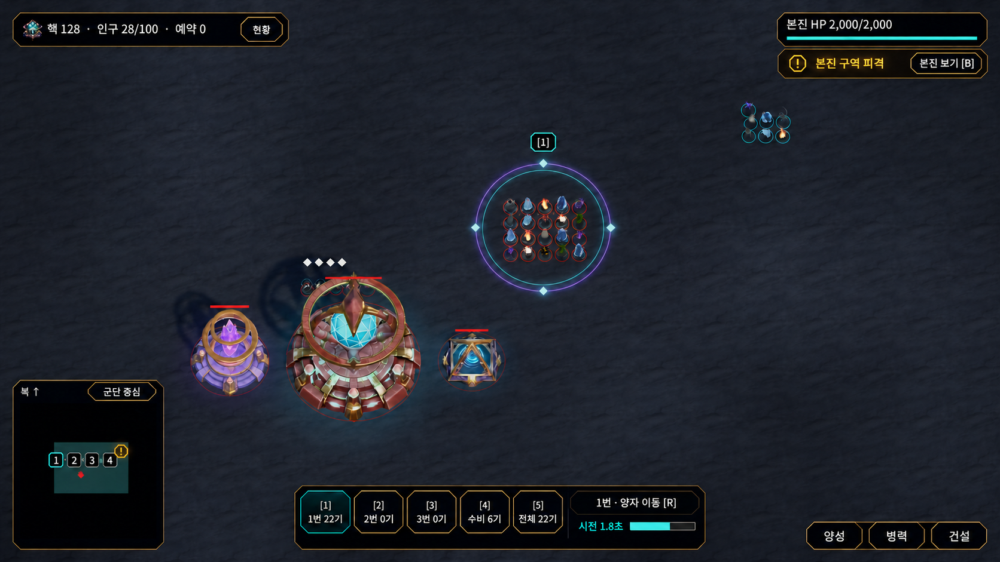
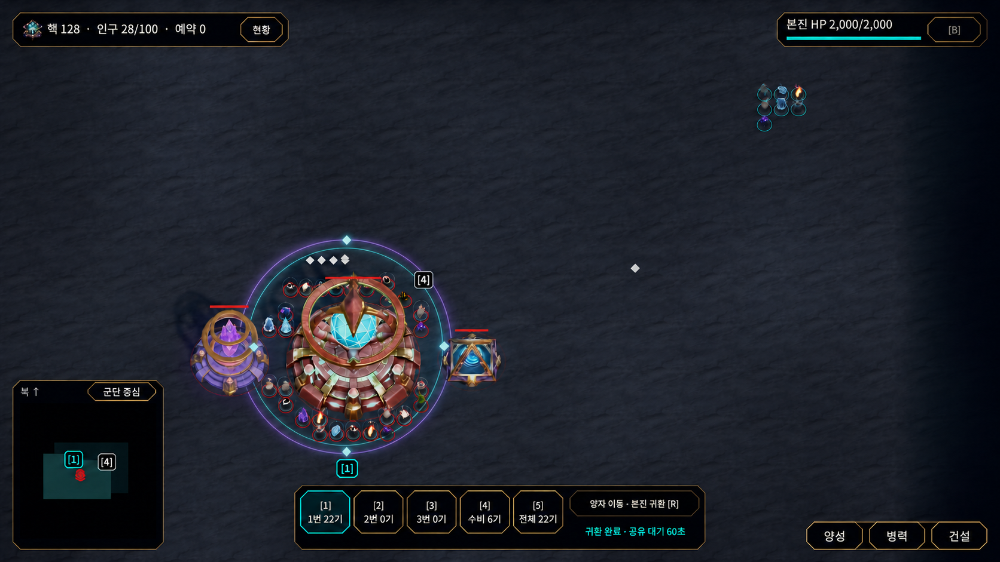

# 첫 플레이 UX 시안

2026-11-11 · 개편안 · 16:9 화면 7장

[첫 플레이 UX 구현 계획](../../Plans/2026-11-11-first-play-ux.md)

현재 Unity Editor 캡처를 내장 이미지 생성 도구의 입력으로 사용했다. 시안에서는 새 표식과 문구가 기존 HUD와 전장에 어떻게 보이는지 확인할 수 있다. 화면의 인원과 잔고는 예시이며 실제 표시 조건은 기획서를 따른다. [첫 플레이 UX 기획서](../../기획서/2026-11-11-first-play-ux.md) · [기존 HUD의 캡처와 검증 기록](../../Reports/2026-11-11-ui-controls.md)

| 화면 | 적용할 표시 |
| --- | --- |
|  | **첫 이동 요청** · 선택한 1번 옆에서 우클릭을 발견한다. 핵 옆에 획득 조건, 클릭한 바닥에는 점선 고리와 `이동 요청`을 표시한다. |
|  | **이동 반영과 핵 획득** · 서버가 반영한 목적지는 실선 고리로 표시한다. 내 핵을 얻은 자리와 왼쪽 위 잔고에서 같은 `◇ +5`를 읽는다. |
|  | **시설 선택과 배치** · 시설 카드에서 역할과 비용을 확인한다. 선택한 포집기는 전장에 반투명 모델과 `배치 가능`으로 나타난다. |
|  | **양성 비용과 진행** · 물 1기, 8핵, 목적 2번을 실행 버튼에서 함께 확인한다. 현재 양성의 진행과 다음 예약을 같은 창에서 읽는다. |
|  | **수비대에서 2번으로 지원** · 병력 창 윗줄에 G 집결을 둔다. 빠른 전송의 실제 출발 2기, 2번의 증원 2기, 미니맵의 이동 점 두 개를 함께 보여 준다. |
|  | **본진 경보와 양자 이동 시전** · 같은 `!`를 본진 HUD와 미니맵에 붙인다. `본진 보기 [B]`는 한 곳에 두고, 선택한 1번의 양자 고리와 하단 시전 표시를 함께 보여 준다. |
|  | **양자 이동 완료** · 본진 주변에 도착한 1번에 같은 양자 고리를 표시한다. 수비대 4번과 번호를 구분하고, 하단에 귀환 완료와 공유 대기를 표시한다. |

첫 이동 안내는 합류 병력이 있는 야전 분대에 표시한다. 핵 증가량은 내 획득을 서버가 확인했을 때, 귀환 완료와 공유 대기는 실제 도착이 확인됐을 때 표시한다.

이미지 생성 프롬프트

공통 프롬프트

> Use case: precise-object-edit, production-fidelity UI mockup for Elemental Legion. Produce one edge-to-edge 16:9 PC gameplay frame from the attached actual Unity Editor gameplay capture. Image 1 is the EDIT TARGET; subsequent images are UI references only. Match the real orthographic overhead camera, gray-blue stone, small existing elemental sprites, actual bronze/blue facility models, and the thin gold bevel / nearly black HUD. Keep 1–5 at bottom center, minimap bottom left, resource and base bars top corners and 양성 / 병력 / 건설 bottom right. No captions outside the HUD, no split screen, no big UI cards, no new terrain, no watermark. Remove the old centered instructional sentence if present. Make only the state edits below. Typeset new quoted Korean copy verbatim in the screenshot's clean sans serif with strong contrast.

**첫 이동 요청** · Editor 참조 Hud

> First move immediately after a right click. Over the existing main formation in the center-right put one small cyan outlined [1] badge and the little text “바닥 우클릭 · 이동”. At the nearest existing white diamond to its right put a small target-local chip “◇ 핵 · 접근하면 획득”. Right beside that diamond, on the ground, draw one small thin pale dashed hollow destination circle with a white mouse cursor and the local status “이동 요청”. Keep those two visual clusters compact so the units are unobstructed. Show the top-left balance at “핵 128”; the core is still on the ground, no gain yet.

**이동 반영과 핵 획득** · Editor 참조 Hud

> The subsequent moment in the same scene and camera. Move the selected formation slightly toward the white diamond to its right, keeping the same units and small cyan [1] badge. That nearby core has just been collected: replace only that diamond with a compact floating “◇ +5” at the pickup point. Add the same “◇ +5” immediately beside the updated “핵 133” in the top-left resource capsule. Slightly beyond the pickup point, show the actual destination with a small continuous cyan ground ring and “이동 중”. Keep the first movement instruction absent. Make the two +5 cues easy to match without a big beam or banner.

**시설 선택과 배치** · Editor 참조 Construction

> Show the construction window open on the right as in the target. Preserve its existing building icons and grid. Select the existing collector tile with a restrained cyan outline, and put “핵 수급 · 20핵” under “포집기”. Under “응집로” put “병력 양성 · 30핵 · 한도”. Under “자연 수호 위성” put “본진 방어 · 40핵”. Keep the other existing tiles and HUD layout. In unoccupied ground to the upper left of the existing base, display a translucent blue preview of the collector matching its bronze ring/white energy tile icon, with a thin footprint outline and the short label “포집기 · 배치 가능”. Show it as a ghost preview, not an additional finished building. No wide tutorial overlay.

> Change just the existing ghost model below “포집기 · 배치 가능” in the upper-left world. Use the exact silhouette of the collector in Image 2: a low ring-shaped intake bowl on a squat circular metal base, four raised curved prongs around the open circular well. No central crystal, no hovering orbital rings, no sparks in placement preview. Make it a small translucent cyan outline ghost with a round footprint, about half the main base diameter. Keep all panel text and other scene objects unchanged.

**양성 비용과 진행** · Editor 참조 TrainingQueue

> Show the natural training panel exactly where it is. Preserve the seven element icons and two rows of numbered choices; water “물 (주력)” is selected, quantity 1 is selected, destination squad 2 is selected (not 4). Replace the cyan confirmation button's text with “물 1기 · 8핵 → 2번”. Immediately below it show the actual running job “양성 중 · 물 → 2번 · 4초” and a small horizontal progress bar. Keep the reservation list below; show distinct pending items without duplicating that running job. Current squad selection at bottom center remains 1.

> Restore the small right-end recall section within the bottom-center squad strip, as it appears in Image 2 (five numbered cards followed by the button “양자 이동 · 본진 귀환 [R]”). Preserve the highlighted number 1 and the rest of the frame. In the right training panel, keep “물 1기 · 8핵 → 2번”. Render the running job label “양성 중 · 물 → 2번 · 남은 4초” with the progress bar filled about one third. Leave the two pending jobs below it.

**수비대에서 2번으로 지원** · Editor 참조 Forces, QuickTransfer

> The forces panel is open and the player has just quick-transferred the two available guards to squad 2. Keep 1 selected at bottom center. At the top of the right forces panel place the compact guard rally row “4 수비대 → 2번 · 1기 [G]”, target choices 1, 2, 3 with 2 selected, and subtle disabled state text “수비대 0기”. Keep the four squad rows and the small “재편” button, show the destination row as “2번 · 합류 0기 · 증원 2기”. Just above the bottom squad strip add one concise confirmation “4 → 2 · 2기 출발”. In the existing minimap show numbered markers 1–4 and exactly two tiny cyan moving unit points spaced between 4 near the base and 2; no speculative route line. Show two actual small elemental sprites in transit near the base. Leave empty ground open and center readable.

> Correct these small HUD details only. The top-left population is “인구 24/100”. In the right Forces panel, 1 is still the selected squad: its first row uses the cyan outline that matches the bottom 1 key, and squad 2 has a normal thin gold outline with only “증원 2기” accented in cyan. In the G row, dim the unavailable action text “4 수비대 → 2번 · 1기 [G]” since “수비대 0기”; keep the three target selectors and selected 2. Preserve “4 → 2 · 2기 출발”, the two movement dots, and bottom active 1. Do not add any panels.

**본진 경보와 양자 이동 시전** · Editor 참조 RecallCasting, BaseAlert

> Show one real base-under-attack alert during a confirmed cast by the still-selected field squad 1. Preserve the stone battlefield, actual camera and positions of units and buildings. Replace the lone red cast circle on the center-right formation with a subtle cyan-violet concentric double ring on the ground, with four little diamond ticks, with a small [1] badge overhead. The top-right base capsule contains a compact amber exclamation icon, “본진 구역 피격” and the adjacent button “본진 보기 [B]”. The minimap places the same small amber ! on the own base close to marker 4. No inferred enemy direction. At the bottom center beside R, show “1번 · 양자 이동 [R]”, “시전 1.8초” and a compact partially filled progress bar. Keep the field and element sprites visible through the ring.

> Edit the top-right base capsule only. There must be just ONE B button. Keep the base HP and its bar on the top line, remove the redundant little old [B] above, and keep a single bottom row within the same slim footprint that contains amber !, the exact words “본진 구역 피격”, and one right-aligned button “본진 보기 [B]”. Preserve the existing quantum ring under squad 1, the amber ! on the minimap, and all other HUD.

**양자 이동 완료** · Editor 참조 RecallCooldown

> This is the moment immediately after successful quantum recall. Keep the existing base models and the base-centered camera. Around the returned elemental units next to the base, add a subtle cyan-violet concentric double ring on the ground with four small diamond ticks, identical in style to a recall cast ring but fading. Put one compact cyan [1] marker over the arrived squad and retain a separate small [4] near the defenders. Leave squad 1 selected in the bottom strip. Change the R status below the button to “귀환 완료 · 공유 대기 60초”. The minimap places [1] by the base and still shows the separate [4]. No full-screen glow or auto camera effect; preserve the established HUD composition.

> IMPORTANT: the arrived field squad is the 22 small red-outlined elemental sprites wrapped around the large bronze-blue base in the LOWER LEFT-CENTER. Move the arrival effect and cyan [1] badge from the remote upper right to those exact base-adjacent sprites. Make one faint cyan/violet double ring with four little diamond ticks centered on the big home base at approximately x=35%, y=62% of the full frame, circling its footprint and the units. This is the same ring style as Image 2. Put the [1] badge immediately below the lower edge of the base-adjacent formation in open ground. Keep the small [4] near the separate guards. The remote blue group at upper right has NO quantum ring and NO squad-number badge. Preserve the minimap and “귀환 완료 · 공유 대기 60초” at the bottom. Keep all actual structures, art and HUD positions.

보정 공통 프롬프트

> Use case: precise-object-edit. The first attached image is the existing 16:9 Elemental Legion game screenshot mockup to edit. Match its size, camera, crisp Hangul, black/gold HUD, textures, proportions and relative positions. Preserve all other text and graphics. The second image is only a visual reference for the specific correction below. Output the same entire edge-to-edge game screenshot without added captions.

