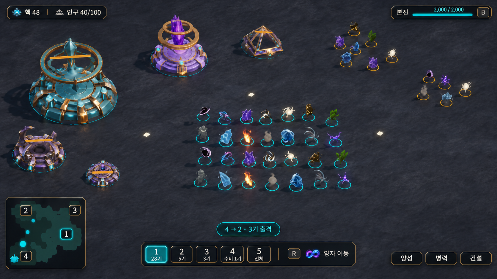
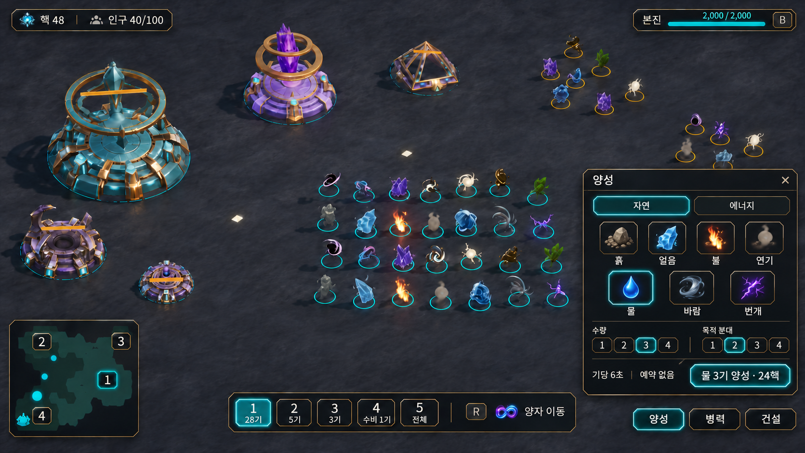
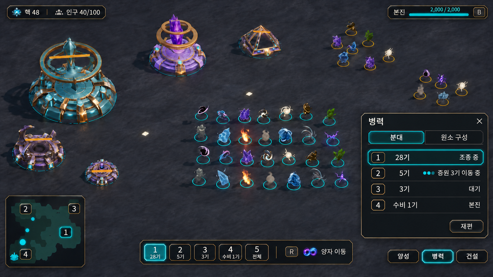
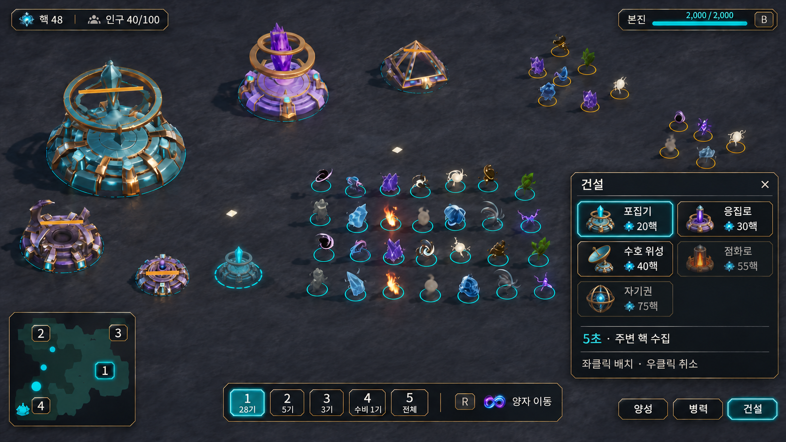
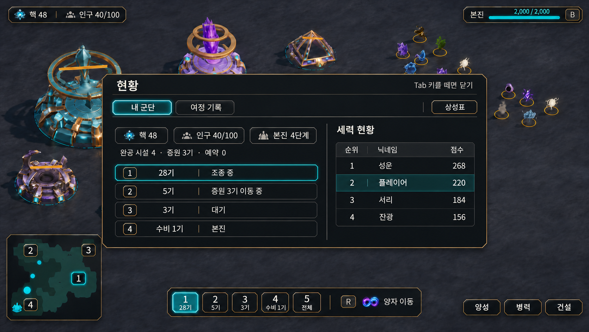
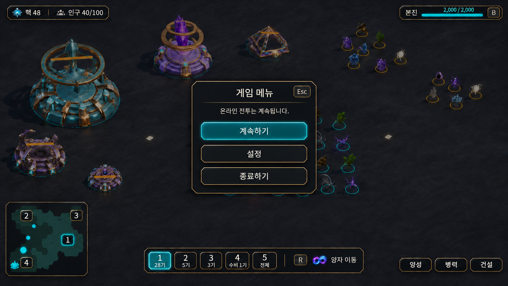
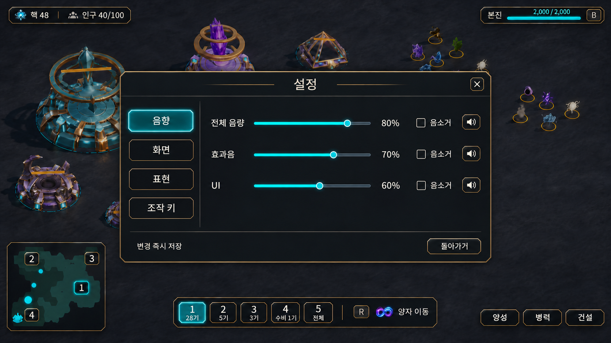
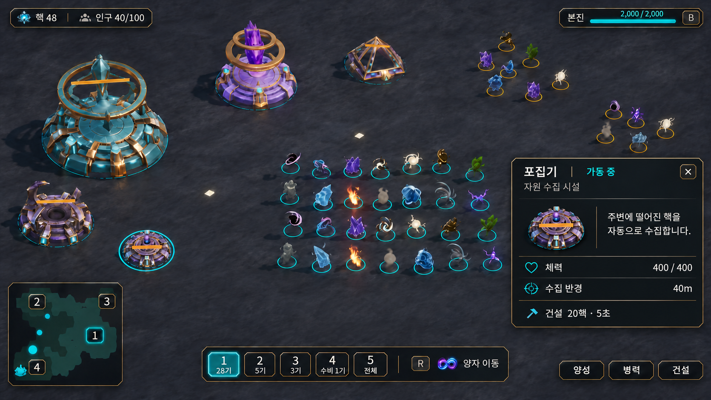
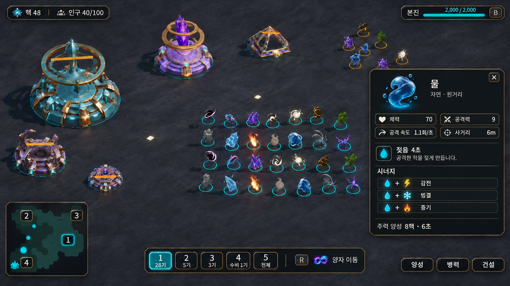

# UI 시안 인덱스

2026-11-11 대화에서 만든 9개 화면이다. [UI·분대 단축키 구현 계획](../../Plans/2026-11-11-ui-controls.md)과 함께 확인한다. 미리보기를 누르면 원본 PNG를 연다.

시안은 내장 이미지 생성 도구로 만든 배치 참조다. 플레이어 현황·순위·음량은 예시이고, 실제 UI는 서버 관측과 게임 데이터를 표시한다. 기본 HUD를 바탕으로 창을 하나씩 연 장면을 비교한다.

| 번호 | 화면과 원본 | 미리보기 | 확인할 배치 |
| --- | --- | --- | --- |
| UI-01 | [기본 전투 HUD](2026-11-11-hud-panels/hud-base.png) |  | 상시 HUD, 1~5, 양자 이동, 번호가 있는 미니맵 |
| UI-02 | [양성 창](2026-11-11-hud-panels/hud-training.png) |  | 자연/에너지, 수량·목적 버튼, 비용과 확정 |
| UI-03 | [병력 창](2026-11-11-hud-panels/hud-forces.png) |  | 합류 인원과 이동 중 증원, 구성·재편 진입 |
| UI-04 | [건설 창](2026-11-11-hud-panels/hud-construction.png) |  | 시설 비용, 선택 상태, 전장 배치 미리보기 |
| UI-05 | [현황판](2026-11-11-hud-overlays/hud-dashboard.png) |  | 내 군단, 공개 점수, 여정 기록·상성표 진입 |
| UI-06 | [ESC 메뉴](2026-11-11-hud-overlays/hud-escape.png) |  | 계속하기·설정·종료하기, 온라인 전투 계속 안내 |
| UI-07 | [설정창](2026-11-11-hud-overlays/hud-settings.png) |  | 음향 탭 예시, 화면·표현·조작 키 탭 |
| UI-08 | [건물 소개창](2026-11-11-hud-overlays/hud-building-info.png) |  | 포집기의 기능·체력·수집 반경·건설 비용 |
| UI-09 | [원소 소개창](2026-11-11-hud-overlays/hud-element-info.png) |  | 물의 기본 능력치·젖음·시너지·주력 양성 |

## 구현할 때 함께 확인할 항목

- 기본 HUD에는 핵·인구·예약과 본진 경보, 분대 인원·조합 안내·R 상태를 표시한다.
- 양성의 실제 대기열·개별 취소, 병력의 예약·지정 수량 재편·G 집결, 건설의 업그레이드·타워 원소 선택은 구현 계획의 완료 조건을 따른다.
- 현황판의 여정 기록·상성표와 설정의 화면·표현·조작 키는 시안과 같은 프레임에서 구성한다.
- 물의 8핵·6초는 물이 주력인 장면의 예시다. 원소·시설의 실제 설명과 수치는 데이터에서 읽는다.
- 번호 겹침·이동 점의 깜빡임·포인터·키 입력은 실제 실행 화면에서 확인한다.

## 생성 기록

- [기본 HUD와 양성·병력·건설 창의 생성 프롬프트](2026-11-11-hud-panels/prompts.md)
- [현황·ESC·설정·소개창의 생성 프롬프트](2026-11-11-hud-overlays/prompts.md)

