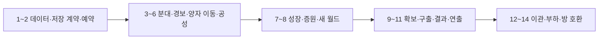

# 메인 게임 개선 구현 계획

> **에이전트 실행 지침:** 구현을 요청받으면 `superpowers:subagent-driven-development` 또는 `superpowers:executing-plans`를 적용해 아래 작업을 순서대로 수행한다. 체크박스는 구현 진행 상태다. 현재는 계획서 작성 단계다.

**Goal:** 상시 월드에서 여러 분대를 지휘하고, 양자 이동으로 본진 습격에 대응하며, 교전 뒤 확보·구출·경제 압박을 선택하는 플레이를 구현한다.

**Architecture:** 기존 단일 스레드 `SimulationWorld`와 명령·관측·복제 경로를 확장한다. 소유자는 네 개의 고정 분대 상태를 가지며, 서버가 이동·인구 예약·귀환·전향 후보를 판정한다. 새 상태는 기능을 추가하는 작업마다 저장·승계·시야 필터에도 함께 반영한다.

**Tech Stack:** Unity 6000.6.0f1, 기존 uGUI·TMP·URP와 입력 체계, .NET 10 서버, C# 9 / netstandard2.1 공유 코드, 기존 LiteNetLib·WSS·Newtonsoft.Json·xUnit.

**Spec:** [메인 게임 개선안](../기획서/2026-11-06-main-world-improvement.md). 2026-11-09에 추가한 [양자 이동](../기획서/2026-11-06-main-world-improvement.md#양자-이동)까지 포함한다.

2026-11-09 작성. 조사 기준은 `ff3f0bb`와 작업공간의 기획 문서 변경분이다. 이 문서는 구현 순서와 검증 방법을 정한다. 기획의 시험값이 실제 재미·성능을 검증받았다는 의미는 아니다.

## 공통 제약

- 서버가 인증된 세션의 소유자를 사용해 판정한다. 클라이언트는 방향·목적지·분대·주문 의도만 보낸다.
- 게임 수치 원본은 `shared/Data/gamedata.json`이다. 신규 시험값을 `_meta.placeholderPaths`에 기재하고 로딩 경계에서 검증한다. 코드·인스펙터·별도 운영 프로필에 밸런스 원본을 복제하지 않는다.
- 공유 코드는 C# 9 / netstandard2.1과 Unity 비의존성을 지킨다. 이동·귀환 배치에 Unity 물리를 사용하지 않는다.
- 20Hz 고정 틱과 기존 UDP/WSS 전송을 유지한다. 숨은 개체·좌표·상태는 사건·실패 사유·재접속 응답에도 포함하지 않는다.
- 상시 월드와 본진 파괴에 따른 개인 패배를 구현 대상으로 삼는다. 근원 쟁탈전의 12분 제한·관문·재점화·32/200기 수치를 이 계획에 가져오지 않는다.
- 원소 14종·시너지 6종·시설의 기존 역할과 비용을 비교 기준으로 둔다. 대시·운반 자원·전방 연결 시설·영구 전투 능력치 보상은 추가하지 않는다.
- 운영 저장과 시험 저장을 분리한다. 원본·정상 백업을 덮어쓰지 않고, 데이터 해시 검사를 느슨하게 만들어 옛 저장을 로드하지 않는다.
- 기존 사용자 변경을 보존한다. 새 의존성과 전면적인 UI·ECS·네트워크 프레임워크 교체 없이 기존 구현을 재사용한다.

## 승인된 결정

**2026-11-09 사용자 승인.** D1~D7의 권고안을 모두 승인받았다. 아래 정책을 구현 기준으로 삼는다. 기능의 효용과 시험값 채택은 원본의 플레이 검증 기준으로 확인한다. 분대의 선택과 카메라 전환을 어떻게 연결할지는 별도 조작 검토 항목이다.

| 결정 | 승인된 정책과 영향 | 적용 작업 |
| --- | --- | --- |
| D1 · 디스크 재시작과 대기열 | 저장된 주문·비용은 보존한다. **구형 디스크 파일에는 양성 시작/완료 틱이 없어 정확한 잔여 시간을 복구할 수 없다.** 구형 디스크 이관은 첫 주문을 추가 비용 없이 전체 시간으로 재시작하는 경로로 정리한다. 신규 스키마부터 남은 시간을 저장하고, 디스크 재시작 뒤 유령 상태에서는 정지했다가 동일 계정 복귀 때 재개한다. 자발적 로그아웃의 기존 취소·환불과 구분한다. 호스트 승계는 기존의 정확한 타이머 복원을 유지한다. | 작업 1의 저장 계약, 작업 12의 운영 이관 |
| D2 · 최대 4기 예약 | 한 명령에서 1~4기를 전부 접수하거나 전부 거부한다. 전체 대기열은 소유 인구 예산까지 허용하고, 현재 진행 항목의 취소 제한과 대기 항목의 개별 취소를 유지한다. | 작업 7 |
| D3 · 무료 시작 원소의 보상 | PvP·유령 만료뿐 아니라 중립에게 죽었을 때도 무료 원소에서 전향·구출·핵을 만들지 않는다. 중립을 거치는 부계정 수확을 막기 위한 확장이다. 정규 획득 원소와 기존 저장 원소에는 소급하지 않는다. | 작업 2, 작업 9 |
| D4 · 양자 이동의 피격·공격 | 적 또는 중립의 유효 타격과 지속 피해가 체력이나 방벽을 줄이면 취소하고, 시전 중에는 분대의 자동 공격·추적을 멈춘다. 이동 명령은 즉시 취소한다. 성공에만 공유 60초 대기를 적용한다. | 작업 5 |
| D5 · 후보 경합과 막타 분대 | 두 당사자 외의 플레이어도 경합시키되 중립은 경합에서 제외한다. 승자의 확보 권한은 막타 당시 분대에 고정하고, 그 분대가 전멸하면 같은 소유자의 다른 분대가 대신 확보하지 못한다. 구출은 원본대로 직전 소유자의 생존 분대가 맡는다. | 작업 9 |
| D6 · 교전 요약의 범위 | 첫 버전은 현재 여정의 누적 확정 결과와 마지막 요약 확인 이후의 변화량을 보여 준다. 별도 교전 종료 타이머·무제한 계정 이력을 만들지 않는다. 접속 복귀 때 같은 기준을 이어 간다. | 작업 10 |
| D7 · 기존 수비대의 상한 초과 | 구형 저장의 수비대가 새 레벨별 상한을 넘으면 ID 순으로 상한만큼 4번에 남기고 나머지는 1번으로 합류하는 증원으로 바꾼다. 변환 순간의 좌표·체력·개체 수는 보존한다. 일괄 삭제·자동 체력 회복은 하지 않는다. | 작업 12 |

귀환 구역의 수용 가능성은 작업 5에서 기하 검사로 확인한다. 기존 시설을 보존한 채 필요한 슬롯을 만들 수 없으면 해당 저장의 이관을 중단하고 배치 정책을 다시 결정한다. ‘120기 시험’은 작업 13에서 **두 소유자의 40 대 80 교전 합계**로 정의하며, 소유자당 100기 상한과 구분한다.

2026-11-09 추가 확인: 이동 중인 증원이 적을 처치하면 합류 목적 분대가 후보의 인구 예약과 확보 권한을 갖는다. 피해·상태 부여 당시 목적 분대를 저장하며, 실제 확보 시간은 정식 합류 원소가 쌓는다. 빈 목적 분대로 향하는 원래 처치 증원이 살아서 합류 중이면 권한을 유지하되, 전멸로 소멸한 권한을 다른 신규 증원으로 되살리지는 않는다.

## 현재 구조와 변경 경계

| 현재 코드에서 확인한 사실 | 변경을 시작할 위치 |
| --- | --- |
| `PlayerState`에 중심·방향·진형·시너지 마스크가 하나씩 있다. `UnitState`는 수비 여부를 bool로 보유한다. | [WorldState.cs](../../shared/Runtime/Sim/WorldState.cs), [MovementSystem.cs](../../shared/Runtime/Sim/MovementSystem.cs), [CombatSystem.cs](../../shared/Runtime/Sim/CombatSystem.cs), [ReactionSystem.cs](../../shared/Runtime/Sim/ReactionSystem.cs) |
| 양성 대기열·예약 비용·대기 항목 취소·양성소 파괴 처리는 이미 있다. 한 명령에서 한 기를 접수하고 완료하면 수비대로 만든다. | [TrainingSystem.cs](../../shared/Runtime/Sim/TrainingSystem.cs), [SimCommand.cs](../../shared/Runtime/Sim/SimCommand.cs) |
| JSON에 귀환 시전 시간이 있지만 실행 코드는 없다. 건물 피해는 자기권 흡수 뒤 본진에 적용된다. | [GameRules.cs](../../shared/Runtime/Data/GameRules.cs), [SiegeSystem.cs](../../shared/Runtime/Sim/SiegeSystem.cs) |
| 전향은 사망 처리에서 즉시 확정한다. 전향과 저장 복원은 `AddUnit`을 거치지 않고 유닛 목록을 직접 구성하는 경로도 있다. | [EconomySystem.cs](../../shared/Runtime/Sim/EconomySystem.cs), [WorldCheckpoint.cs](../../shared/Runtime/Sim/WorldCheckpoint.cs) |
| 명령 파서·관측을 UDP와 WSS가 공유한다. 단일 중심 좌표·상대 좌표 양자화·예측·보간을 사용한다. | [Protocol.cs](../../shared/Runtime/Net/Protocol.cs), [Snapshot.cs](../../shared/Runtime/Net/Snapshot.cs), [UdpGameServer.cs](../../server/Server/UdpGameServer.cs), [OnlineRooms.cs](../../server/Server/OnlineRooms.cs) |
| 카메라는 추종·미니맵 검사·중심 복귀를 지원한다. 서버 카메라 시야는 단일 군단 중심에 붙는다. | [LegionCamera.cs](../../client/Assets/_Project/Scripts/Runtime/Camera/LegionCamera.cs), [ClientBootstrap.cs](../../client/Assets/_Project/Scripts/Runtime/Bootstrap/ClientBootstrap.cs), [VisibilitySystem.cs](../../shared/Runtime/Sim/VisibilitySystem.cs) |
| 디스크 복원은 유령 전환과 작업 취소를 수행한다. 호스트 승계는 진행 상태·명령·난수를 그대로 복원하는 별도 경로다. | [SimulationWorld.cs](../../shared/Runtime/Sim/SimulationWorld.cs), [MigrationWorldState.cs](../../shared/Runtime/Sim/MigrationWorldState.cs), [FileWorldStore.cs](../../server/Server/FileWorldStore.cs) |

Graphify는 후보를 찾는 데 사용하고 원본 소스로 대조했다. 일부 클라이언트 파일은 그래프 생성 시점보다 최신이어서 해당 관계는 소스를 기준으로 확인했다. 구현 착수 시에는 [Graphify 규칙](../Rules/graphify.md)에 따라 색인을 갱신한다.

## 인터페이스와 상태의 소유권

아래 이름은 **새로 추가하거나 확장할 계약**이다. 이미 존재하는 API라고 가정하지 않는다. 인게임 표기는 ‘양자 이동 · 본진 귀환 [R]’을 사용하고 내부 식별자는 기존 `recall`을 이어 쓴다.

| 계약 | 파일과 책임 |
| --- | --- |
| `SquadState`, `SquadOrderKind { Hold, MoveDir, MoveTo }` | 새 `shared/Runtime/Sim/SquadState.cs`. 소유자 안의 1~3번 야전·4번 수비 상태, 중심·방향·목적지·진형 변경 표시·시너지 마스크·적용 입력 번호를 보유한다. |
| `UnitState.SquadId`, `DestinationSquadId`, `IsReinforcing`, `FreeOrigin`, `RescuedOnce` | 기존 `WorldState.cs`. 합류 중인 원소와 정식 분대원을 구분하고, 무료 출처·구출 이력을 원소 ID와 함께 유지한다. `Converted`는 별도 표지로 보존한다. |
| `BuildingState.FreeOrigin` | 기존 `WorldState.cs`. 신규 입장 때 무상 지급한 원시핵만 표시한다. 유령 만료 시 해당 본진의 시설 정액 핵을 제외하고 저장·승계한다. 기존 저장 본진에는 소급 적용하지 않는다. |
| `SimCommand.Move(ulong sequence, byte squadMask, Vector2 direction)`, `MoveTo(ulong sequence, byte squadMask, Vector2 destination)` | 기존 `SimCommand.cs`. 비트 0~3을 분대 1~4에 대응한다. 전체 야전 선택은 `0b0111`이다. 서버가 마스크·유한 좌표·월드 경계·수비 범위를 검사한다. |
| `SimCommand.Transfer(ulong sequence, byte fromSquad, byte toSquad, int count)`, `Rally(ulong sequence, byte targetSquad, int count)` | 본진 범위 안의 재편과 수비대 일부 출격. 대상은 인증 소유자의 분대로 한정한다. 서버가 안정적인 유닛 ID 순으로 수량을 고르고 체력·상태·이력을 유지한다. |
| `SimCommand.Train(ulong sequence, string element, int count, byte targetSquad)`, `Recall(ulong sequence, byte squadId)` | 양성 묶음과 귀환 의도. 소유자 필드를 클라이언트 입력에 넣지 않는다. |
| `SimCommand.Focus(ulong sequence, byte anchorSquad)` | 서버 카메라 시야 기준을 자기 야전 1~3 또는 본진에 해당하는 4번으로 정한다. 미니맵의 임의 좌표를 새 시야 원점으로 받지 않는다. |
| `SquadView`, `ConversionCandidateView`, `JourneyResultView` | 기존 `ObservationViews.cs`와 `WorldView.cs`에서 읽기 전용 결과를 정의한다. 분대의 상세 명령·예약·귀환 대기·여정 손익은 소유자에게만 제공한다. 후보 위치와 월드 연출은 관측 범위에서만 제공한다. |
| `RecallSystem.Start(WorldState world, PlayerState player, byte squadId) : CommandFailure`, `CompleteDue(WorldState world) : void` | 새 `RecallSystem.cs`. 한 소유자의 단일 시전과 공유 대기를 관리한다. 완료 전에 현재 생존·본진·배치를 검증한다. |
| `ConversionRecoverySystem.Tick(WorldState world) : void` | 새 `ConversionRecoverySystem.cs`와 `ConversionCandidateState.cs`. 후보 ID·원래 원소 ID·양측 소유자·막타 분대·진행·만료·예약을 관리한다. |
| `WorldState.TryReserveUnitSlots(int count) : bool`, `ReleaseUnitSlots(int count) : void` | 기존 상태의 전역 예산 진입점. 업무별 예약 ID는 기존 양성 주문 ID·후보 ID·중립 자리 ID에 붙여 중복 소비·반환을 막는다. 소유 인구와 수비대 배정 예산도 같은 작업에서 검사한다. |

패킷 계약에는 `NetworkUnit.SquadId`, `IsReinforcing`과 `LegionPose.SquadId`를 추가한다. 자기 분대별 중심·적용 입력 번호를 전달하되 선택 분대의 예측 보정만 해당 분대의 합류 원소에 적용한다. 전송·파서·복제·표현을 같은 작업에서 바꾸고 레코드 크기에 맞춰 청크 용량을 다시 계산한다. 현재 프로토콜은 v16이며 새 계약의 최종 버전은 v17로 올려 구형 클라이언트를 명시적으로 거부한다. 착수 시 버전이 달라졌다면 현재 버전을 기준으로 다시 정한다.

설계 선택은 고정된 네 분대, 기존 명령 큐, 작업별 작은 상태, 기존 DTO·체크포인트다. 범용 스킬 프레임워크·거래 서비스·이벤트 소싱은 도입하지 않는다. 분대 2·3이 비어도 ID를 재사용하거나 바꾸지 않아 증원과 입력의 목적지가 다른 부대로 바뀌지 않게 한다.

## 수치와 용량 계약

아래는 전체 기능을 갖춘 첫 시험군의 목표값이다. **작업 1~6에서는 기존 3기·20/30/40/50기를 유지하고**, 새 시작 분배 필드는 3기/0기로 읽는다. 12기·8기/4기·확대 인구는 작업 7에서 적용한다. 테스트에서는 기존 `JObject` 방식으로 목표값을 구성해 로더 계약을 먼저 확인한다.

| 항목 | 데이터 경로와 구현 값 |
| --- | --- |
| 시작 | `start.unitCount=12`, 새 `start.fieldUnitCount=8`, `start.garrisonUnitCount=4`, `start.startingCores=0`. 합계와 레벨 1 수용량을 검증한다. |
| 소유 인구 | `population.max=100`, `baseLevels[].populationCap=30/50/75/100`. 새 `baseLevels[].garrisonCap=8/12/16/20`. 야전별 별도 상한은 두지 않는다. 사용하지 않는 `population.base/perBaseLevel`은 참조를 확인해 정리하고 레벨 표에서 계산한다. |
| 지휘·수비 | 새 `legion.squads.fieldCount=3`, `legion.garrisonRadius=25`. 슬롯 간격·합류 반경·집결 가속은 기존 진형·집결 값을 재사용한다. |
| 양성 | 새 `training.maxBatchCount=4`. 기당 주력 8핵·6초, 일반 자연 10핵·8초, 에너지 17핵·13.6초. 기존 비용·시간 경로를 재사용한다. |
| 양자 이동 | 기존 `legion.recall.castSeconds=3`, `cancelOnHit=true`, 새 `cooldownSeconds=60`. 시전 60틱, 성공 후 공유 대기 1,200틱이며 시작 틱 기준 오차를 테스트로 고정한다. |
| 경보·공성 | 새 `legion.defenseAlarm.repeatSeconds=5`, `buildings.base.incomingDamagePerSecond=250`. 본진 2,000HP, 20Hz에서 합산 12.5HP/틱. 자기권 흡수 뒤 본진 체력에 들어가는 피해에만 적용한다. |
| 후보 | 새 `economy.pvpRecovery`에 `lifetimeSeconds=20`, `secureSeconds=3`, `radius=5`, `convertedHealthRatio=0.5`, `rescuedHealthRatio=0.25`. 기존 PvP 60%와 중립 80%를 유지한다. 원소당 구출은 한 번이다. |
| 새 월드 배치 | 새 `neutral.opening`에 첫 자연 거리 35~70m·다음 무리 간 70~140m, `economy.opening`에 첫 핵 거리 20~35m·묶음 크기 4·분당 가까운 묶음 3/공용 묶음 2. 수급 총량 20핵/인/분과 자연 재생성 300초를 유지한다. |
| 현재 세력 점수 | 기존 `score.building=10`, `baseLevel=25`, `unit=2`, `battleWin=0`. 누적 공성 승리는 별도 여정 기록에서 보여 준다. |

전역 유닛 예산은 `live + waitingTraining + reservedNeutralVacancies + recoveryCandidates <= 4096`이다. 활동 중인 소유자와 유령은 같은 최대 15개 소유자 예산에 포함한다. 이동 중 증원은 이미 `live`이므로 전역·소유 인구에서 다시 세지 않는다. 양성 완료와 후보 회수는 예약을 생존 개체로 교환한다. 구출은 전역 예약을 유지하고 소유자 예약만 넘긴다. 포화 시 새 예약을 거부하거나 중립 재생성을 연기한다.

기준 산술은 `ceil(1680² × 180 / 1,000,000) × 4 + 15 × 100 = 3536`으로 여유가 560기다. 후보·생산 예약으로 이 여유를 중복 사용하지 않는다. 후보 객체·전투 사건·표현 풀·신뢰 전송 큐는 유닛 수와 다른 용량이므로 각각 상한을 검증한다. 프로토콜의 4,096기·1,024B 데이터그램·게임플레이 1MiB 제한은 임의로 확대하지 않는다.

## 틱 순서와 단계 의존성



`SimulationWorld.Step`의 입력 → 이동 → 전투 → 사망·탈락 순서를 유지한다. 입력에서 귀환 시작·이동 취소를 적용하고 전투에서 피격 취소와 시설 경보를 기록한다. 사망·본진 탈락·유령 만료를 처리한 뒤 귀환 완료와 후보 처리를 실행한다. 후보는 만료를 먼저 처리하고 남은 대상의 확보·구출을 판정한다. 양성·생태·핵 처리 뒤 시야를 다시 계산한다. 순간이동과 부활 뒤 공간 인덱스를 다시 유효하게 만들어 후보 거리 판정에 이전 좌표를 사용하지 않는다.

각 작업은 해당 기능의 저장·승계 왕복 테스트를 포함한다. 작업 12까지 저장 지원을 미루지 않는다. 운영 저장의 실제 변환과 배포는 마지막 검증을 통과한 뒤에만 수행한다.

모든 상태 추가 작업의 공통 수정 범위는 `shared/Runtime/Sim/WorldCheckpoint.cs`, `MigrationWorldState.cs`다. 네트워크에 보이는 필드를 추가하면 `shared/Runtime/Net/GameplayFrame.cs`, `GameplayCodec.cs`, `GameplayReplicationState.cs`, `GameplayReplica.cs`와 `Docs/protocol.md`를 함께 갱신한다. 아래 파일 목록에서 공유 시뮬레이션의 축약명은 `shared/Runtime/Sim/`, Unity 런타임 축약명은 `client/Assets/_Project/Scripts/Runtime/`, 서버 테스트 축약명은 `server/Tests/`를 기준으로 한다.

## 작업 목록

### 작업 1 · 시험 기준과 데이터·저장 계약

**파일:** 수정 `shared/Runtime/Data/GameRules.cs`, `GameDataDocument.cs`, `shared/Data/gamedata.json`, `shared/Runtime/Sim/WorldCheckpoint.cs`, `MigrationWorldState.cs`, `server/Server/FileWorldStore.cs`. 테스트 `server/Tests/GameRulesTests.cs`, `GameDataDocumentTests.cs`, `M5PersistenceTests.cs`, `MigrationStateTests.cs`.

**인터페이스:** 기존 `GameRules(GameDataDocument)`와 `SimulationWorld.CaptureCheckpoint/CaptureMigrationState`를 유지한다. 새 수치는 위 표의 경로로 읽으며, `WorldCheckpoint.SchemaVersion`과 파일 래퍼 형식을 v2로 정해 게임 데이터 해시와 별도로 검증한다. 신규 스키마에 양성 시작/완료 틱·다음 주문 ID를 저장한다. D1에 따라 디스크 복귀 계약을 먼저 기록한다. 일반 로더와 명시적인 v1 변환 진입점은 구분한다.

- [x] 현재 데이터·저장 샘플과 해시를 복구용 경로에 보관한다. 같은 시드의 3기·기존 인구 기준과 시험값 비교 절차를 기록한다. 시험은 기존 `--save-dir`로 분리하고 데이터 변경은 JSON 원본에서 수행한다.
- [x] `MainWorldRulesValidateBudgets`를 추가한다. 시험값을 구성한 테스트에서 `Assert.Equal(12, rules.StartUnitCount)`, 레벨별 인구·수비 합계·확률·유한 거리와 시간·`guard <= total`을 검사한다. 작업 1의 기본 JSON은 기존 시작·인구를 유지하는지도 따로 검사한다. 누락 키·음수·범위 역전·과대 틱을 거부하는 테스트도 둔다.
- [x] 테스트가 새 규칙 미지원으로 실패하는지 확인한 뒤 로더와 DTO 버전을 최소 확장한다. 구형 해시를 일반 로더가 거부하는 기존 동작을 보존한다. 비교용 데이터 변경은 테스트의 `JObject`에서만 만들고 운영 프로필을 추가하지 않는다.
- [x] `dotnet test server/Tests/ElementalLegion.Tests.csproj --filter "FullyQualifiedName~GameRulesTests|FullyQualifiedName~GameDataDocumentTests|FullyQualifiedName~M5PersistenceTests|FullyQualifiedName~MigrationStateTests" -m:1 -nodeReuse:false`가 통과해야 한다.
- [x] 관련 파일만 검토하고 `feat: define main world trial rules and save contracts` 단위로 커밋한다.

### 작업 2 · 인구 예약과 무료 출처

**파일:** 수정 `WorldState.cs`, `SimulationWorld.cs`, `TrainingSystem.cs`, `EconomySystem.cs`, `WorldEcology.cs`, `PlayerLifecycle.cs`, `WorldCheckpoint.cs`, `MigrationWorldState.cs`는 모두 `shared/Runtime/Sim/` 아래다. 새 테스트 `server/Tests/UnitReservationTests.cs`, `FreeOriginTests.cs`.

**인터페이스:** 위의 `TryReserveUnitSlots/ReleaseUnitSlots`와 작업별 예약 ID를 사용한다. 소유 인구·수비대 배정·전역 예산을 모두 확인한 뒤 한 번에 접수한다. 실패하면 비용·개체·예약 어느 것도 바뀌지 않는다.

- [x] `GlobalCapacityIsSharedAcrossSpawnTrainingAndRecovery`에 `Assert.True(live + reservations <= 4096)`를 고정한다. 남은 한 슬롯에서 입장·양성·재생성이 경쟁해 하나만 성공하고, 취소·사망·중복 정리 후 예약이 한 번만 반환되는 사례를 추가한다.
- [x] D3에 맞춰 `FreeOriginCannotBeFarmed`와 `FreeStartingBaseDoesNotDropGhostBuildingCores`를 추가한다. 원소의 PvP·중립 사망·유령 만료와 무료 원시핵의 유령 만료를 각각 검사한다. 재접속·재시작·승계 뒤에도 표지가 이어지고 기존 저장 원소·본진에는 소급하지 않아야 한다.
- [x] 먼저 실패를 확인한 뒤 초기 배치·새 입장·양성·생태의 `AddUnit` 호출과 전향·복원의 직접 삽입을 모두 연결한다. 신규 무료 원소와 원시핵 생성 경로를 표시하고 유령 만료의 시설 정액 지급에도 적용한다. 중립이 전향돼 빈 자리가 생길 때도 새 재생성 예약을 확보해야 한다.
- [x] `dotnet test server/Tests/ElementalLegion.Tests.csproj --filter "FullyQualifiedName~UnitReservationTests|FullyQualifiedName~FreeOriginTests|FullyQualifiedName~TrainingBotTests|FullyQualifiedName~M4EcologyTests" -m:1 -nodeReuse:false`와 저장·승계 왕복을 통과시킨다.
- [x] `feat: account for unit reservations and free starting assets`로 분리한다.

### 작업 3 · 독립 분대와 기본 지휘를 끝까지 연결

**파일:** 새 `shared/Runtime/Sim/SquadState.cs`, `SquadSystem.cs`. 수정 `WorldState.cs`, `MovementSystem.cs`, `SimulationWorld.cs`, `SimCommand.cs`, `WorldView.cs`, `ObservationViews.cs`, `CombatSystem.cs`, `ReactionSystem.cs`, `WorldCheckpoint.cs`, `MigrationWorldState.cs`. 통신은 `shared/Runtime/Net/Protocol.cs`, `Snapshot.cs`, `GameplayFrame.cs`, `GameplayCodec.cs`, `GameplayReplica.cs`, `GameplayReplicationState.cs`, `ClientConnection.cs`와 `server/Server/UdpGameServer.cs`, `OnlineRooms.cs`, `OnlinePeer.cs`다. 클라이언트는 `Input/LegionInput.cs`, `ControlBindings.cs`, `Bootstrap/ClientBootstrap.cs`, `Legion/MovementPrediction.cs`, `SnapshotTimeline.cs`, `LegionPresentation.cs`, `ElementalVisuals.cs`, `ElementalVisuals.Spacing.cs`, `UI/CombatHud.cs`를 수정한다. 새 테스트 `server/Tests/SquadCommandTests.cs`; 기존 `ReactionEconomyTests.cs`, `M3ProtocolTests.cs`, `ClientMotionTests.cs`, `client/Assets/_Project/Tests/EditMode/ElementMotionTests.cs`를 확장한다.

**인터페이스:** `Move/MoveTo/Transfer`와 `SquadState/SquadView`. `SquadSystem.Apply(WorldState world, PlayerState player, SimCommand command) : CommandFailure`가 검증된 의도를 실행한다. 위치·분대 ID를 관측·스냅샷에 일관되게 반영한다.

- [x] `SquadsKeepIndependentOrders`에서 1번만 움직이고 2번의 지점 이동과 4번의 대기가 유지됨을 검증한다. `MoveToStopsAndHolds`는 도착 뒤 이동이 멈추는지, 전체 선택 마스크가 수비대를 제외하는지 확인한다. NaN·무한 좌표·잘못된 마스크·타인 분대는 변경 없이 거부해야 한다.
- [x] `ReactionSourcesRemainBoundToOriginalSquad`에서 같은 소유자의 다른 분대를 섞어 시너지를 발동할 수 없고, 상태 부여 뒤 재편해도 과거 출처가 바뀌지 않음을 검증한다. 선행 타격과 연기·영역 효과의 분대 출처도 포함한다.
- [x] 실패를 확인한 뒤 기존 이동·진형·시너지 처리를 분대 단위로 바꾼다. 재편은 본진 범위의 합류 병력만 대상으로 한다. 합류 중 원소는 목적지만 가지며 도착 전 시너지에 포함하지 않는다.
- [x] 1~4 선택과 전체 야전 선택, WASD·방향키·우클릭 의도를 실제 UDP와 WSS 공용 파서에 연결한다. 키를 놓으면 직전에 직접 지휘한 분대에 정지 입력을 보내고, 선택 변경만으로 다른 분대의 지점 명령을 취소하지 않는다. `Protocol.Version`과 `Docs/protocol.md`를 함께 갱신한다.
- [x] 예측은 선택한 자기 분대 중심에 기존 `MovementPrediction`을 재사용하고 선택 변경 시 서버 기준 상태로 재시작한다. 나머지는 서버 상태로 보간한다. 전체 야전 선택에서 예측할 대표 분대는 가장 낮은 번호로 고정하고, 다른 분대도 즉시 표시되는 명령 목적지로 조작 피드백을 준다. `PredictionOffsetAffectsOnlySelectedJoinedSquad`를 추가해 본체·진형 마커 모두 분대 ID와 합류 상태를 검사하는지 확인한다. 멀리 정지한 2번·수비대·이동 중 증원에 1번의 보정값이 더해지면 실패다.
- [ ] `dotnet test server/Tests/ElementalLegion.Tests.csproj --filter "FullyQualifiedName~SquadCommandTests|FullyQualifiedName~ReactionEconomyTests|FullyQualifiedName~M3ProtocolTests|FullyQualifiedName~ClientMotionTests|FullyQualifiedName~MigrationStateTests" -m:1 -nodeReuse:false` 통과와 2인 조작 확인 후 `feat: command independent field squads`로 분리한다.

### 작업 4 · 수비대 지휘·본진 시점·소유자 경보

**파일:** 수정 `SquadSystem.cs`, `TrainingSystem.cs`, `SiegeSystem.cs`, `VisibilitySystem.cs`, `WorldView.cs`, `SimCommand.cs`, 통신의 `GameplayCodec.cs`, `ClientConnection.cs`, 클라이언트 `Bootstrap/ClientBootstrap.cs`, `Camera/LegionCamera.cs`, `UI/CombatHud.cs`, `UI/CombatHud.Layout.cs`, `Input/ControlBindings.cs`. 새 테스트 `server/Tests/DefenseAlertTests.cs`, `client/Assets/_Project/Tests/EditMode/SquadControlTests.cs`; 기존 `FogAdversarialTests.cs`, `LegionCameraTests.cs`를 확장한다.

**인터페이스:** `Rally/Focus`와 소유자 전용 `BaseUnderAttack` 사건을 `SimEventKind`에 추가한다. 기존 명령 접수·시퀀스·빈도 제한을 사용한다.

- [x] `GuardOrdersStayWithinBaseRadius`와 `RallyMovesOnlyRequestedCount`를 작성한다. 25m 경계, 수비 상한 예약, G의 지정 수량, 재출격·이동 중 사망·합류를 검사한다. B 카메라 전환은 선택과 부대 명령을 바꾸지 않아야 한다.
- [x] `DefenseAlertIsOwnerOnlyAndCoalesced`에서 첫 피해 경보, 100틱 안의 같은 구역 중복 억제, 다른 소유자 경보 독립성을 검사한다. 숨은 공격자의 ID·위치·방향·음향이 응답에 남으면 실패다.
- [x] 실패를 확인한 뒤 실제 시설 피해 지점에서 경보를 생성한다. 원형 시야는 모든 자기 유닛·시설에서 유지하고, 추가 직사각 카메라 시야는 인증된 자기 분대 또는 본진 기준 하나만 사용한다. 임의 미니맵 좌표로 시야를 넓히지 않는다.
- [x] 경보 → B 본진 확인 → 4 수비대 선택 → 이동 명령을 UI와 입력에 연결한다. 소리 없이 같은 상태를 읽을 수 있게 하고 알림 구독은 화면 종료 때 해제한다. 카메라·시야 계약을 `Docs/Rules/architecture.md`와 `Docs/protocol.md`에 반영한다.
- [x] `dotnet test server/Tests/ElementalLegion.Tests.csproj --filter "FullyQualifiedName~DefenseAlertTests|FullyQualifiedName~SquadCommandTests|FullyQualifiedName~FogAdversarialTests" -m:1 -nodeReuse:false`와 두 EditMode 테스트를 통과시킨 뒤 `feat: control base guards and receive raid alerts`로 분리한다.

### 작업 5 · 양자 이동

**파일:** 새 `shared/Runtime/Sim/RecallSystem.cs`. 수정 `SimulationWorld.cs`, `CombatSystem.cs`, `SiegeSystem.cs`, `ConstructionSystem.cs`, `WorldState.cs`, `WorldEcology.cs`, 관측·통신 계약, `WorldCheckpoint.cs`, `MigrationWorldState.cs`, 클라이언트 `Bootstrap/ClientBootstrap.cs`, `Legion/SnapshotTimeline.cs`, `MovementPrediction.cs`, `UI/CombatHud.cs`. 새 테스트 `server/Tests/RecallTests.cs`; 기존 `ClientMotionTests.cs`, `MigrationStateTests.cs`를 확장한다.

**인터페이스:** `RecallSystem.Start/CompleteDue`, `SimCommand.Recall`, 소유자별 시전 분대·완료 틱·`RecallReadyTick`. 귀환 성공에는 불연속 이동 번호를 붙여 예측·보간을 재기준화한다.

- [x] 먼저 귀환 슬롯을 기하 검사한다. 기존 슬롯 간격과 본진 충돌 반경을 사용해 건설 범위 안의 격자 후보를 거리·좌표순으로 정렬하고 최대 야전 수용량의 슬롯을 고정한다. 건물 겹침·맵 밖을 제외하고 해당 슬롯은 건설 금지로 예약한다. 1/30/100기, 맵 가장자리, 수비대·적 점유, 기존 시설 보존 사례를 검사한다. 조건을 충족하지 못하면 배치·이관을 진행하지 않는다.
- [x] `RecallIsAtomicAndUsesSharedCooldown`에 시전 시작 `t`의 `t+59`까지 미완료, `t+60`에 생존 전원 이동, 성공 틱부터 1,200틱 공유 대기를 고정한다. 체력·상태·개체 ID가 보존돼야 한다.
- [x] `DamageAndBaseLossWinOnCompletionTick`과 `BlockedRecallNeverPartiallyMovesSquad`를 추가한다. D4의 타격 범위, 이동 취소, 마지막 틱 사망·본진 파괴·슬롯 부족, 동시 두 분대 시도, 합류 중 증원의 제외를 검증한다.
- [x] 실패를 확인한 뒤 사망·탈락 처리 뒤에 완료 판정을 연결한다. 배치 전체를 임시 검사한 뒤 한 번에 적용한다. 기존 `TrainingSystem.ReservePosition`의 혼잡 시 원점 반환은 귀환에 재사용하지 않는다. 단절은 시전을 취소하며 성공 대기는 유지한다.
- [x] 순간이동을 장거리 보행으로 보간하지 않고, 과거 위치 스냅샷이 뒤늦게 와도 되돌리지 않는다. 소유자에게 시전·취소·대기를, 다른 플레이어에게 관측 가능한 출발·도착만 보낸다. 실패는 숨은 점유자 신원을 포함하지 않는다.
- [x] `dotnet test server/Tests/ElementalLegion.Tests.csproj --filter "FullyQualifiedName~RecallTests|FullyQualifiedName~ClientMotionTests|FullyQualifiedName~MigrationStateTests|FullyQualifiedName~FogAdversarialTests" -m:1 -nodeReuse:false` 통과 후 `feat: recall a squad with quantum movement`로 분리한다.

### 작업 6 · 본진의 합산 피해 속도 시험

**파일:** 수정 `shared/Runtime/Sim/SiegeSystem.cs`, `WorldState.cs`, `WorldCheckpoint.cs`, `MigrationWorldState.cs`. 테스트 `server/Tests/M4SimulationTests.cs`; 새 `BaseDefenseBudgetTests.cs`.

**인터페이스:** 본진별 현재 틱의 잔여 체력 피해 예산. `SiegeSystem.Attack`에서 자기권 흡수 뒤 본진 `ApplyDamage` 직전에만 사용한다.

- [x] `AllAttackersShareBaseHullBudget`에서 공격자 수·원소·타격 순서가 달라도 한 본진의 틱 피해가 12.5를 넘지 않음을 검사한다. 예산이 사용된 틱 중간 상태를 잘못 재사용하지 않게 승계 검사도 추가한다.
- [x] `DomeAndOuterBuildingsKeepNormalDamage`와 `FullBaseNeeds160DamageTicks`를 추가한다. 자기권 직접 공격, 자기권 초과 피해, 서로 다른 본진, 손상된 본진, 예산 소진 뒤 유령·개인 패배 처리를 검증한다.
- [x] 실패를 확인한 뒤 본진 예산을 적용한다. 초과 피해를 다음 틱에 적립하지 않고 실제 적용 피해만 사건·손익에 기록한다.
- [ ] `dotnet test server/Tests/ElementalLegion.Tests.csproj --filter "FullyQualifiedName~BaseDefenseBudgetTests|FullyQualifiedName~M4SimulationTests|FullyQualifiedName~MigrationStateTests" -m:1 -nodeReuse:false`를 통과시킨다. 2~4인에서 경보 인지·첫 입력·약 5초 내 개입과 공격자의 외곽 시설 성과를 비교한다.
- [ ] 소형 시험 결과를 별도 보고서에 기록하고 피해 제한의 채택 여부를 결정한다. 채택 시 `feat: budget incoming base hull damage`로 분리한다.

### 작업 7 · 12기 출발·4기 주문·실제 증원

**파일:** 수정 `SimulationWorld.cs`, `TrainingSystem.cs`, `MovementSystem.cs`, `SquadSystem.cs`, `ObservationViews.cs`, `WorldCheckpoint.cs`, `MigrationWorldState.cs`, 통신 계약과 클라이언트 `UI/CombatHud.cs`, `UI/CombatHud.Layout.cs`. 테스트 `server/Tests/TrainingBotTests.cs`; 새 `ReinforcementTests.cs`.

**인터페이스:** `Train(sequence, element, count, targetSquad)`과 목적 분대·예약 ID를 포함한 기존 양성 주문. 수량은 개별 취소 가능한 기존 순차 주문으로 펼친다. 소유자별 `NextTrainingOrderId`에서 주문 ID를 발급하고 저장·승계한다. 클라이언트 명령 순번과 다른 번호 체계이므로 `Protocol.TryReadCommand`, `SimulationWorld.TryEnqueue`, `MigrationWorldState` 복원에서 기존 `TrainingOrderId < Sequence` 검증을 제거하고 해당 소유자의 대기 주문 ID 조회로 권한을 검사한다. 명령 자체의 순번·재전송 검사는 유지한다.

- [x] D2에 따라 `BatchTrainingIsAtomicAndSequential`를 작성한다. 주력 4기는 32핵과 4개 인구 슬롯을 한 번에 예약하고 6초 간격으로 한 기씩 나온다. 자원·소유 인구·전역 예산 중 하나라도 부족하면 전부 거부한다.
- [x] `ReinforcementCountsOnceAndFightsWhileTravelling`, `TrainingFailureReleasesEachReservationOnce`, `BatchOrderIdsAreIndependentFromCommandSequence`를 추가한다. 이동 중 전투·사망, 빈 목적 분대의 재사용, 목적 분대 귀환·탈락, 대기 취소·양성소 파괴·재접속을 검사한다. 완료 전·이동 중·도착 뒤 인구 합계가 일정하고, 여러 묶음의 하위 주문·취소 명령 번호가 충돌하지 않아야 한다.
- [x] 실패를 확인한 뒤 기존 대기열과 집결 이동을 확장한다. 빈 야전 분대는 본진에서 시작하고, 귀환한 분대를 향한 증원은 서버가 정한 현재 중심으로 이동한다. 목적지·합류 상태를 임의로 다른 분대에 넘기지 않는다.
- [x] 시작 8기/4기와 30/50/75/100·수비 8/12/16/20을 적용한다. 수비대 목적 양성은 수비 하위 상한도 예약하고, 야전 목적 증원은 출생 직후 이동하므로 수비대 배정으로 중복 세지 않는다. 여전히 본진에서 실제로 출발한다.
- [x] `dotnet test server/Tests/ElementalLegion.Tests.csproj --filter "FullyQualifiedName~ReinforcementTests|FullyQualifiedName~TrainingBotTests|FullyQualifiedName~UnitReservationTests|FullyQualifiedName~FreeOriginTests" -m:1 -nodeReuse:false`와 저장 왕복 후 `feat: train batches into selected squads`로 분리한다.

### 작업 8 · 새 월드의 초반 경로와 자리별 수급

**파일:** 수정 `shared/Runtime/Sim/WorldEcology.cs`, `WorldCheckpoint.cs`, `MigrationWorldState.cs`, `server/Server/ScenarioFactory.cs`. 테스트 `server/Tests/M4EcologyTests.cs`; 새 `OpeningRouteTests.cs`.

**인터페이스:** 생태 저장 DTO에 자리 ID·가까운/공용 공급 위치·잔여 공급 크레딧·다음 공급 틱을 포함한다. 신규 월드 배치와 기존 월드 복원의 진입점을 구분한다.

- [x] `OpeningRoutesRespectDistancesAndBudget`에서 같은 시드의 핵 20~35m·첫 자연 35~70m·다음 무리 70~140m, 건물/자동 교전 경계, 중앙 에너지 지역과 양쪽 접근 가능성을 검사한다. 도달 불가능한 자리를 보상 생성으로 보정하지 않는다.
- [x] `ReenteringSlotDoesNotRefillOpeningResources`에서 첫 자원이 공급 한도에 포함되고 같은 자리에 재입장해도 공급 주기·크레딧이 초기화되지 않음을 검사한다. 활성 인원 변화·빈 자리·유령 처리의 분당 총량은 현행 공급 기준과 같은 조건에서 비교한다.
- [x] 실패를 확인한 뒤 기존 소유자별 매 3초 핵 생성에서 자리별 공급으로 바꾼다. 4핵 묶음의 3/2 배분과 총 20핵/인/분을 함께 만족시키며, 중립은 300초 재생성과 전역 예약 실패 시 대기를 유지한다.
- [ ] 기존 저장은 본진·시설·중립 좌표를 유지한다. 변환 시 기존 생태 일정에서 공급 크레딧을 옮기고 초기 자원을 다시 지급하지 않는다. 1,680m 월드의 격자와 인접 자리 336m도 바꾸지 않는다.
- [ ] `dotnet test server/Tests/ElementalLegion.Tests.csproj --filter "FullyQualifiedName~OpeningRouteTests|FullyQualifiedName~M4EcologyTests|FullyQualifiedName~M5PersistenceTests" -m:1 -nodeReuse:false` 통과 후 2~4인에서 첫 보상 20초 이내·첫 시설 90초 안팎·3/10/25분 인구를 기록하고 `feat: place early routes and persist slot resource budgets`로 분리한다.

### 작업 9 · PvP 전향 후보·확보·구출

**파일:** 새 `shared/Runtime/Sim/ConversionCandidateState.cs`, `ConversionRecoverySystem.cs`. 수정 `EconomySystem.cs`, `ConversionRules.cs`, `SimulationWorld.cs`, `VisibilitySystem.cs`, `WorldState.cs`, `WorldCheckpoint.cs`, `MigrationWorldState.cs`, `GameplayFrame.cs`, `GameplayCodec.cs`, `GameplayReplica.cs`, `GameplayReplicationState.cs`. 새 테스트 `server/Tests/ConversionRecoveryTests.cs`; 기존 `ReactionEconomyTests.cs`, `FogAdversarialTests.cs`를 확장한다.

**인터페이스:** 원소 ID를 보존한 후보와 `ConversionRecoverySystem.Tick`. 사망 때 난수 추첨은 한 번만 하고 예약·출처·권한을 고정한다. `Converted`와 `RescuedOnce`를 분리한다.

- [x] `NeutralConversionStillJoinsImmediately`와 `PvpConversionRequiresUncontested60Ticks`를 작성한다. 중립 80% 즉시 합류·현재 합류 체력, PvP 60% 추첨·5m·3초·전향 체력 50%를 고정한다. 전향 이력이 있거나 타워 처치·인구 부족인 경우 기존 드롭 규칙을 따른다.
- [x] `RescueIsOnceAndTransfersReservation`에서 원소 ID·기존 전향 표지 유지, 체력 25%, 가장 가까운 분대·동률 번호, 구출 한 번을 검사한다. 자기 범위 이탈은 그쪽 진행 초기화, D5의 적 진입은 정지로 구분한다.
- [x] `ExpiryWinsAgainstCompletionOnTick400`과 `RecoveryCannotDuplicateAfterOwnerLoss`를 추가한다. 400틱 만료·60틱 확보 경합, 완료 틱 이동/사망/탈락, 양측·제3자 개입, 막타 분대 전멸, 소유자 단절, 수용 부족, 재접속·승계·중복 결과를 검사한다.
- [x] 실패를 확인한 뒤 사망과 개인 탈락 뒤 후보를 처리한다. 막타 소유자가 탈락해도 후보의 전역 예약·만료는 후보가 소유하며, 원래 소유자가 활동 중이면 구출을 시도할 수 있다. 전향·구출·만료 중 하나가 확정되는 순간만 예약을 소비/이전/반환한다.
- [x] 위치·잔여 시간은 현재 관측 가능한 후보에만, 확보/구출의 상세 진행은 권한 있는 소유자에게만 제공한다. 숨은 경합자의 존재를 중단 사유로 직접 설명하지 않는다. 후보 수·사건 수·직렬화 크기는 경계에서 제한한다.
- [ ] `dotnet test server/Tests/ElementalLegion.Tests.csproj --filter "FullyQualifiedName~ConversionRecoveryTests|FullyQualifiedName~ReactionEconomyTests|FullyQualifiedName~UnitReservationTests|FullyQualifiedName~FogAdversarialTests|FullyQualifiedName~MigrationStateTests" -m:1 -nodeReuse:false` 통과와 40 대 80의 추격/확보 두 분기 비교 후 `feat: secure conversions and rescue fallen elements`로 분리한다.

### 작업 10 · 현재 세력 순위와 여정 결과

**파일:** 수정 `shared/Runtime/Sim/VisibilitySystem.cs`, `ObservationViews.cs`, `WorldView.cs`, `WorldState.cs`, `WorldCheckpoint.cs`, `MigrationWorldState.cs`, `shared/Runtime/Net/GameplayFrame.cs`, `GameplayCodec.cs`, `GameplayReplica.cs`, `server/Server/GameplayReport.cs`, `NetworkWorld.cs`, 클라이언트 `UI/CombatHud.cs`, `ObservatoryUi.cs`, `Bootstrap/ClientBootstrap.cs`. 새 테스트 `server/Tests/JourneyResultTests.cs`; 기존 `M3CombatResultTests.cs`, `M5PersistenceTests.cs`를 확장한다.

**인터페이스:** `JourneyResultView`는 여정 ID와 확정 전향·구출·손실·핵 유입/소비·시설 파괴·공성 승리의 누적 카운터를 제공한다. D6의 이전 확인 기준과 함께 소유자에게만 보낸다. 공개 순위는 현재 점수·기존 공개 식별자만 유지한다.

- [x] `StandingReflectsCurrentForceOnly`에서 완공 비본진 시설 10점·레벨 25점·생존 원소 2점을 검사한다. 공성 승리·예약 후보·미완공 시설이 점수를 부풀리지 않아야 한다.
- [x] `JourneyResultsAreFinalOwnerOnlyAndSurviveResume`에서 후보 생성만으로 보상을 기록하지 않음, 전향·구출·만료 중 단일 결과, 중복 패킷/승계 뒤 이중 누적 방지, 패배 뒤 새 여정과 동일 계정 복귀 구분을 검사한다.
- [x] 실패를 확인한 뒤 기존 카운터와 확정 사건을 활용해 결과를 집계한다. 상대 경제·시야 밖 타인의 교전 내역은 요약에 포함하지 않는다. 상태가 아닌 클라이언트 효과음/애니메이션 횟수로 집계하지 않는다.
- [x] 현재 세력 현황, 마지막 확인 이후 손익, 개인 패배 결과·새 입장 선택을 UI에 연결한다. LAN/AI전의 기존 승리 이벤트와 상시 월드의 개인 패배를 구분한다.
- [x] `dotnet test server/Tests/ElementalLegion.Tests.csproj --filter "FullyQualifiedName~JourneyResultTests|FullyQualifiedName~M3CombatResultTests|FullyQualifiedName~M5PersistenceTests|FullyQualifiedName~AiMatchTests" -m:1 -nodeReuse:false` 통과 후 `feat: show current force and journey results`로 분리한다.

### 작업 11 · 조작 안내와 대군의 시청각 표현

**파일:** 수정 `client/Assets/_Project/Scripts/Runtime/UI/CombatHud.cs`, `CombatHud.Layout.cs`, `ObservatoryMap.cs`, `Legion/LegionPresentation.cs`, `ElementalVisuals.Ownership.cs`, `ElementalVisuals.Outcomes.cs`, `CombatAudio.cs`, `Bootstrap/ClientBootstrap.cs`; 필요할 때 해당 설정 자산과 `Editor/ClientSceneBuilder.cs`의 기존 연결만 수정한다. 새 EditMode 테스트 `MainWorldHudTests.cs`는 `client/Assets/_Project/Tests/EditMode/`에 둔다.

**인터페이스:** 기존 서버 관측·명령 결과를 받아 표현한다. 새 월드 판정 로직을 UI나 VFX에 복제하지 않는다. 조절할 고리 크기·표식·음량·우선순위·표현 풀은 한글 툴팁과 범위가 있는 직렬화 필드로 노출한다.

- [x] `MainWorldHudPreservesSelectionAndExplainsFailures`에서 1~4 인원·목적지·예약, 본진 체력·경보, 양자 이동 시전/대기/실패, 후보 진행/만료를 검사한다. 건설 중 우클릭은 취소가 우선이며 새 지점 명령을 보내지 않아야 한다.
- [x] 실패를 확인한 뒤 ‘양자 이동 · 본진 귀환 [R]’과 분대 고리의 수렴 → 본진 고리의 전개를 연결한다. 색 외에 번호·무늬·텍스트를 사용하고 숨은 위치에는 빛·소리·표식을 만들지 않는다.
- [x] 첫 보상 → 양성 → 분대 배치 → 실제 위험/연습의 경보와 R 순서로 안내한다. 경보음은 일반 전투보다 우선하며 반복을 합친다. 안내·음향이 꺼진 상태에서도 조작할 수 있어야 한다.
- [x] 기존 표현 풀·일괄 갱신을 재사용한다. 원소별 `Update`나 분대별 카메라·전체 월드 복사본을 추가하지 않는다. 스크립트·직렬화 필드 변경에는 `.meta`, 씬·프리팹·생성기 연결을 함께 점검한다.
- [x] `SquadControlTests`, `MainWorldHudTests`, `LegionCameraTests`, 기존 `MigrationPresentationTests`를 Unity EditMode에서 통과시킨다. 실제 카메라의 100기·여러 소유자 밀집 화면은 제작자와 별도 `visual_reviewer`가 확인한 뒤 `feat: present squad defense and recovery feedback`로 분리한다.

### 작업 12 · 기존 저장 이관과 중단 없는 호스트 승계

**파일:** 새 `shared/Runtime/Sim/WorldCheckpointUpgrade.cs`, `server/Server/WorldSaveMigration.cs`. 수정 `WorldCheckpoint.cs`, `MigrationWorldState.cs`, `server/Server/FileWorldStore.cs`, `HostMigrationSnapshot.cs`, `MigrationSnapshotCodec.cs`, `NetworkWorld.cs`, `OnlineRooms.cs`, `Program.cs`, `ServerOptions.cs`, 클라이언트 `Bootstrap/ClientFlow.Migration.cs`. 테스트 `server/Tests/M5PersistenceTests.cs`, `MigrationStateTests.cs`, `HostMigrationIntegrationTests.cs`; 새 `WorldSaveMigrationTests.cs`.

**인터페이스:** `WorldCheckpointUpgrade.Upgrade(string sourceJson, GameRules sourceRules, GameRules targetRules) : WorldCheckpoint`는 명시적으로 지원하는 옛 해시/형식만 변환한다. 변환기 전용 v1 DTO/검증 경로를 같은 파일에 두어 신규 필수 필드가 없는 구형 파일을 일반 v2 로더로 읽지 않는다. `WorldSaveMigration.Run(string sourceDirectory, string destinationDirectory, string sourceDataPath, string targetDataPath) : int`는 운영 프로세스와 분리된 변환 진입점이다.

- [x] `UpgradePreservesExistingAssetsWithoutRegrantingRewards`에서 옛 야전→1번·수비→4번과 D7의 초과 수비대 처리, 좌표·체력·상태·소유자·잔고·저장된 주문·유령 만료, 기존 원소·본진의 정규 출처를 검사한다. 구형에 없는 양성 잔여 시간을 보존했다고 주장하지 않고 D1에서 정한 구형 첫 주문 정책과 신규 스키마의 정확한 타이머 복원을 각각 검사한다. 주문 ID·다음 발급 ID·복귀 후 명령 순번도 충돌하지 않아야 한다.
- [x] `MigrationPreservesEveryInFlightMainWorldOperation`에서 시전 59/60틱·공유 대기, 이동 중 증원, 확보 59/60틱·만료 399/400틱·구출 이력, 예약 ID·난수·미적용 명령·경보 억제·여정 카운터를 중단 없는 실행과 비교한다. 변조·누락·중복·과대 입력은 복원 전에 거부한다.
- [x] 실패를 확인한 뒤 원본의 구형 로더/규칙으로 먼저 검증하고 새 DTO로 매핑한다. 데이터 해시만 교체하는 변환은 금지한다. 원본과 다른 출력 경로, 임시 파일→검증→교체, 원본 해시·전후 개체/잔고 요약을 사용한다. 실패하면 정상 원본과 백업이 남아야 한다.
- [x] 변환 명령은 `--migrate-world <원본폴더> --migration-output <새폴더> --source-data <옛JSON> --target-data <새JSON>`으로 정의한다. 이 옵션은 이 작업에서 신설한다. 루트/동일/하위 경로 충돌과 기존 출력 덮어쓰기를 거부하고 새 경로의 복원 검사를 통과한 파일만 완료로 보고한다.
- [x] 승계는 디스크 유령 전환과 분리하고 틱 경계 복사본을 보존한다. 압축·I/O는 틱 밖에서 수행하며 새 세대에서 예측·복제·사건 버퍼를 비운 뒤 기준 상태를 원자 적용한다. 계정 복귀 키와 중계 비밀값을 백업에 넣지 않는다.
- [x] `dotnet test server/Tests/ElementalLegion.Tests.csproj --filter "FullyQualifiedName~WorldSaveMigrationTests|FullyQualifiedName~M5PersistenceTests|FullyQualifiedName~MigrationStateTests|FullyQualifiedName~HostMigrationIntegrationTests" -m:1 -nodeReuse:false` 통과 후 `feat: migrate and restore main world squad state`로 분리한다. 실제 운영 이관은 작업 14 뒤에 수행한다.

### 작업 13 · AI와 15인 밀집 부하

**파일:** 수정 `shared/Runtime/Sim/BotBrain.cs`, `BotBrainState.cs`, `MovementSystem.cs`, `server/Server/ScenarioFactory.cs`, `BenchmarkRunner.cs`, `GameplayReport.cs`, `Program.cs`, `ServerOptions.cs`, `server/Bots/LoadOptions.cs`, `LoadPeer.cs`, `LoadReport.cs`와 해당 CLI의 런처·README. 기존 `TrainingBotTests.cs`, `AiMatchTests.cs`, `MigrationLoadOptionsTests.cs`를 확장하고 새 `server/Tests/MainWorldLoadScenarioTests.cs`를 추가한다.

**인터페이스:** 기존 `BotBrain`과 정상 명령만 사용한다. 새 시험 시나리오 이름은 `main-world-defense`, `main-world-recovery`, `main-world-dense`로 정의하고 이 작업에서 CLI·런처에 연결한다. `BenchmarkRunner.Run`에 선택한 시나리오를 받는 오버로드를 추가해 `Program`의 봇 분기에서도 실제로 선택하도록 한다. 현행 `--scenario`는 데모 이름만 받고 M0 봇 분기는 시나리오를 전달하지 않으므로 옵션 목록만 확장해서는 완료가 아니다. 자연·양성·후보·유령을 실제로 활동시키는 시나리오를 만든다.

- [ ] `MainWorldBotsUseOnlyObservedState`에서 야전 1번 기본 운영, 수비 일부 출격, 경보 대응·귀환·후보 선택이 자기 관측과 정상 명령을 통과하는지 검사한다. 판단·후퇴·목적 분대 상태의 승계도 확인한다.
- [ ] `DenseScenarioAccountsForLiveAndReservedUnits`에서 15소유자×100기와 중립 최악 2,036기의 산술·실제 배치, 양성/후보/재생성 예약 경합과 4,096 경계를 검사한다. 40 대 80 비교는 총 120기인 별도 시나리오로 구성한다.
- [ ] 실패를 확인한 뒤 기존 봇·계측을 확장한다. `SeparateAllies`의 소유자 내 쌍 비교는 50기 1,225쌍에서 100기 4,950쌍으로 늘어난다. 같은 시드 전후 측정으로 병목일 때만 기존 공간 격자를 이용해 줄이고, 최소 간격과 결정 순서를 보존한다.
- [ ] 전체 서버는 20Hz 50ms 예산의 p99·초과 틱·GC·단계 시간·저장/백업 준비 비용을, 시뮬레이션 단독은 기존 p99 10ms 목표를 따로 기록한다. 1000틱 준비와 10000틱 측정을 기준으로 분산·밀집·연속 교전을 구분하고 사망으로 부하가 줄어든 결과를 최대 부하 성공으로 표시하지 않는다.
- [ ] 측정한 각 군에 해당 임계값을 직접 적용한다. 현행 `BenchmarkResult.Passed`는 `Continuous`를 시간과 무관하게 통과시키므로 종료 코드만으로 새 연속 부하의 예산 충족을 주장하지 않는다. 선택 시나리오가 실제 실행됐고 요구한 부하가 유지됐는지도 결과에 남긴다.
- [ ] UDP/WSS에서 가시 유닛이 넓게 흩어진 경우도 검사한다. 현행 양자화는 `relative / mapSize * short.MaxValue`라 단일 Anchor에서도 월드 전체 차이를 표현한다. 맵 양끝·분대 전환·귀환 전후를 왕복해 1,680m에서 최대 반올림 오차 약 2.56cm 이내인지 검사한다. 같은 프레임의 청크는 Anchor를 유지한다. 분대 필드 추가 뒤 1,024B 청크·조립 원자성·게임플레이 1MiB·신뢰 큐 포화·지연·중복·역순을 검증한다. 상한에 맞게 분할하며 시야 밖 정보를 보내지 않는다.
- [ ] 시나리오 테스트와 전체 회귀를 통과한 뒤 실제 Windows Player CPU/GPU·프레임 시간·가독성과 15인 네트워크 대역폭을 별도 보고하고 `test: cover main world defense recovery and dense load`로 분리한다.

### 작업 14 · 방 호환·악용 검사·배포 판단

**파일:** 수정 `server/Server/UdpGameServer.cs`, `OnlineRooms.cs`, `NetworkWorld.cs`의 입장/종료 접점과 필요한 범위의 `OnlinePeer.cs`, `shared/Runtime/Net/ClientConnection.cs`. 문서 `Docs/protocol.md`, `Docs/design-summary.md`, 분야별 문서의 현재 기준, `README.md`, `Docs/Rules/workflow.md`; 런처 `client/Tools/Start-Server.ps1`, 필요 시 `Start-Server.cmd`. 테스트 `M3PacketSafetyTests.cs`, `M5OnlineTests.cs`, `M5LanTests.cs`, `HostMigrationIntegrationTests.cs`; 새 `MainWorldAdmissionTests.cs`.

**인터페이스:** 기존 계정·복귀 키·세대·데이터 해시 계약을 사용한다. 익명 새 입장은 새 여정으로만 처리하고 기존 자산을 복구할 수 없게 한다. 무료 출처 무보상·자리별 공급으로 익명·새 계정 입장의 자원 증식을 함께 검사한다. 계정 필수화는 별도 정책 결정 없이 도입하지 않는다.

- [ ] `AnonymousAndAccountReentryCannotDuplicateAssets`에서 UDP 익명 hello, 계정 hello, 동일 계정 유령 복귀, 새로운 계정, 오래된 연결·명령을 모두 검사한다. 시작 병력·30초 신규 보호·공유 대기·핵·시설 보상을 재지급할 수 없어야 한다.
- [ ] 2~4인 → 8인 → 15인 순서로 상시 월드, LAN 방, WSS 인터넷 방·AI전·정상/장애 승계를 검증한다. 방 전장은 `ForRoom`의 작은 맵·중립 밀도를 유지하므로 1,680m 거리와 동일한 결과를 가정하지 않는다. 배치가 성립하지 않으면 해당 방 유형의 적용을 보류하고 이유를 기록한다.
- [ ] 전체 빌드·테스트·Editor 컴파일·관련 EditMode·사람 Play·Windows Player 외부망 접속을 각각 기록한다. 기존 테스트 통과, 같은 PC 연결, 공개 터널의 `/rooms` 응답을 새로운 규칙의 재미나 외부 플레이어 검증으로 바꾸지 않는다.
- [ ] 새 CLI와 변환 절차를 더블클릭 런처·README·작업 명령표에 연결한다. 프로토콜·현재 기준 문서는 구현된 범위로 갱신하고 시험값·보류 모드는 구분한다. 외부 자료를 실제 도입했다면 `Docs/third-party.md`에 버전·권리·사용 경로·검증을 기록한다.
- [ ] 전환 전 옛 실행 파일·원본 JSON·계정/월드 저장·정상 백업과 해시를 보관한다. 새 실행 파일·새 JSON·변환한 **별도 저장 경로**를 묶어 전환한다. 실패 시 세 묶음을 모두 이전 상태로 복구한다. 새 형식으로 진행한 상태를 구형 서버에 역으로 넣지 않는다.
- [ ] 확인된 기능·미채택 시험값·미실행 검증을 보고하고 `docs: document main world rollout and validation`로 분리한다. 250HP/초·후보 20초·시작 12기의 채택은 사람 플레이 결과로 결정한다.

## 리뷰에서 우선 확인할 다섯 가지

| 실패하기 쉬운 조건 | 기대 결과와 담당 테스트 |
| --- | --- |
| 귀환 완료·피격·본진 파괴가 같은 틱에 발생 | 사망·탈락과 취소가 우선이고 부분 이동이 없다. 작업 5 `DamageAndBaseLossWinOnCompletionTick`. |
| 양성·전향·구출·중립 재생성이 마지막 슬롯을 동시에 사용 | 전역·소유·수비 예산이 넘지 않고 한 번만 소비/반환한다. 작업 2·7·9의 예약 경합 테스트. |
| 떨어진 분대와 본진을 오가며 시야·예측 기준이 바뀜 | 허용 시야 원점만 사용하고 다른 분대에 예측 보정을 더하지 않는다. 작업 3 `PredictionOffsetAffectsOnlySelectedJoinedSquad`, 작업 4 소유자 경보·시야 시험, 작업 13 월드 양끝 좌표 왕복 시험. |
| 새 입력의 중복·옛 세대 응답이 귀환/후보 결과 뒤에 도착 | 보상·명령을 재적용하거나 이전 위치로 되돌리지 않는다. 작업 5 `RecallIsAtomicAndUsesSharedCooldown`, 작업 9 `RecoveryCannotDuplicateAfterOwnerLoss`, 작업 12 승계 시험. |
| 변환 실패·익명 재입장·중립 경유 무료 원소 수확 | 원본 저장이 남고 자산이 중복 생성되지 않는다. 작업 2 `FreeOriginCannotBeFarmed`, 작업 12 `UpgradePreservesExistingAssetsWithoutRegrantingRewards`, 작업 14 입장 시험. |

## 검증 명령과 완료 기준

각 작업의 지정 테스트를 먼저 실패→성공으로 확인하고 마지막에는 전체 회귀를 수행한다. 신규 테스트 이름과 시나리오/변환 CLI는 위 작업에서 만들 대상이며 현재 지원 여부와 구분한다.

```powershell
dotnet build server/ElementalLegion.sln -m:1 -nodeReuse:false
dotnet test server/ElementalLegion.sln -m:1 -nodeReuse:false
```

서버의 현재 지원 명령은 [작업 절차](../Rules/workflow.md#명령어)를 따른다. 새 시나리오를 연결한 뒤에는 다음 명령을 추가로 실행한다.

```powershell
dotnet run --project server/Server -c Release -- --listen --scenario main-world-defense --report-network --report-gameplay --save-dir .artifacts/main-world-trial/defense
dotnet run --project server/Server -c Release -- --listen --scenario main-world-recovery --report-network --report-gameplay --save-dir .artifacts/main-world-trial/recovery
dotnet run --project server/Server -c Release -- --bots 15 --scenario main-world-dense --report-tick
```

Unity는 사람이 에디터에서 열고 프로젝트 경로를 확인한 뒤 컴파일·지정 EditMode를 확인한다. Play와 최종 Windows Player의 사람 조작·외부망·GPU 검증은 별도 결과를 받는다. 변경 범위와 독립된 리뷰어가 서버 입력·시야·저장/승계·예약 정합성을 검토한 뒤 다음 단계로 진행한다.

| 검증 단계 | 기능 채택 기준 |
| --- | --- |
| 2~4인 방어 | 첫 경보 약 1초, 시전 가능한 분대 약 5초 내 개입. 외곽 시설 공격·퇴로 차단이 공격자의 유효한 선택이어야 한다. |
| 2~4인 성장 | 첫 보상 20초 이내·첫 시설 선택 90초 안팎을 시험하고 3/10/25분 인구·수급·다음 목표 거리를 기록한다. 수치 도달만으로 재미를 통과 처리하지 않는다. |
| 40 대 80 교전 | 추격/확보에 따라 열세 측의 구출·경제 압박·재원정 선택이 실제로 달라져야 한다. 우세 측의 동시 독점이나 확보 대기 지루함이 남으면 재조정한다. |
| 8인 운영 | 제3자 개입·자리 재입장·새 계정/익명·유령·저장에서 보상과 예약이 한 번 처리되고 정보가 새지 않아야 한다. |
| 15인 | 100기씩 분산·밀집과 예약 포화에서 전체 서버 50ms 틱 예산, 별도 시뮬레이션 목표, 대역폭·프레임·가독성 결과를 각각 제시한다. 기준 미달은 해당 범위의 미완료로 남긴다. |

## 요구 추적과 계획서 자체 검증

| 원본 기획의 범위 | 구현 작업 |
| --- | --- |
| 상시 월드·개인 패배·현재 세력과 여정 구분 | 10, 14 |
| 세 야전 분대·수비 지휘·시너지 출처 | 3, 4, 7 |
| 양자 이동·경보·본진 대응 시간 | 4, 5, 6, 11 |
| 대군·양성 예약·실제 증원·무료 지급 악용 | 1, 2, 7, 14 |
| 초반 동선·자리별 자원·중앙 에너지·기존 시설 보존 | 8, 12 |
| 중립 즉시 전향·PvP 확보·구출·역전 선택 | 2, 9, 10, 13 |
| 원소 14종·시너지 6종·시설과 수치 검토 | 3, 6, 8, 13 |
| 세계관·양자 이동 명칭·HUD·학습·시청각 | 5, 10, 11 |
| 서버 권위·시야·전송 한도·봇·저장·승계·방 호환 | 모든 기능 작업의 경계 검사, 12~14 |

2026-11-09에 현재 코드의 기준 빌드와 테스트를 실행했다. 빌드는 오류 0개와 NuGet 취약성 조회 실패 `NU1900` 경고 4개, 테스트는 **337개 통과·실패 0·건너뜀 0**이었다. 이는 기존 코드의 기준 확인이며 위 기능의 구현 검증은 아니다. 기존 복원용 빌드 산출물 경로 `.artifacts/design-docs-20261106`를 재사용했고 새 실행 기능·데이터·씬은 작성하지 않았다.

외부 자료는 [기존 조사 규칙](../Rules/reuse.md)과 [패턴 문서](../Rules/patterns.md)를 적용한다. 이번에는 로컬 구조와 기존 의존성을 조사했다. 새 외부 패키지·에셋의 도입 조사는 수행하지 않았다. 각 구현 작업 시작 시 재사용할 구체 자료가 생기면 공식 원본·이용 조건·고정 버전·호환성을 확인하고 기록한다.
