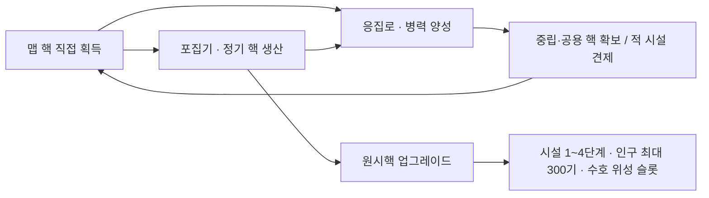

# 중립 배치와 시설 성장 구현 계획

2026-11-13 · 구현 및 검증 기록 포함 · 기준 커밋 `eff426f`

플레이어는 초반에 맵 핵을 직접 모아 포집기와 응집로에 투자합니다. 포집기 수입으로 병력을 보충하거나 원시핵을 성장시키고, 원시핵 단계가 오르면 시설마다 생산·공격·방어 중 필요한 방향을 선택합니다. 중립 무리 사이의 이동 거리를 늘려 양성소의 가치가 생기는지, 원정을 떠날 이유가 남는지 함께 검증합니다.



## 시험 규칙과 수치

아래 값은 첫 플레이테스트용입니다. 현재 시작 12기·0핵, 맵 핵 공급 분당 20개(근처 12개·공용 8개), 전투 드롭과 유닛의 직접 습득을 기준으로 잡았습니다. 원시핵별 포집기·응집로·점화로 각 1기 제한과 기존 건설 해금은 유지합니다. [게임 데이터](../../shared/Data/gamedata.json) · [현행 규칙](../Rules/gameplay.md)

### 중립 무리

- **무리 중심에서 가장 가까운 다음 무리 중심까지 도보 약 60초.** 목표 거리는 `분대 기본 이동속도 × 60초`이고 현재 7m/s에서 420m입니다. 대시·양자 이동·교전 시간은 측정에서 제외합니다. 배치는 420m를 기준으로 하고, 대표 경로의 실제 도보 시간이 55~70초인지 확인합니다. 시작점마다 별도 중립을 추가하는 대신 첫 맵 핵을 가까운 초반 목표로 유지합니다. 첫 중립까지의 거리는 따로 측정합니다.
- **방 크기 시험값.** 2인 방 240m의 대각선은 약 339m입니다. 2인 기준 한 변을 720m로 잡고 현재의 인원 비례 면적 계산과 월드 상한 1,680m를 적용합니다. 2/4/8/15인 방의 한 변은 각각 720/1,018/1,440/1,680m입니다. 720m 방의 배치 예시는 자연 무리 `(150, 80.27)`, `(570, 80.27)`와 에너지 무리 `(360, 444)`입니다. 좌표는 m 단위이며 세 무리의 중심 간격은 모두 약 420m입니다.
- **새 월드의 배치.** 목표 거리가 한 변인 삼각 격자를 사용하고 `WorldEcology`의 시드와 경계·건설·입장 안전 검사를 재사용합니다. 배치 후보는 격자 전체를 함께 옮겨 구하며, 시드로 순서를 정한 유한한 후보 중 에너지 중앙 구역·입장 경로를 지키고 연결된 무리를 가장 많이 놓는 배치를 고릅니다. 중앙에 놓을 수 있는 자리 안에서 기존 비율을 목표로 에너지 무리를 배정합니다. 기본 시험 배치에서 중앙 에너지 무리는 최소 1곳입니다. 자리당 두 무리와 면적×밀도로 정하던 무리 수는 새 배치의 유효한 자리 수로 바꿉니다. 1~4기 규모, 300초 재생성, 전역 인구 예약, 중립 추적·복귀를 이어 씁니다. 재생성은 같은 무리 자리에서 검사하고 막혔으면 기존 재시도 간격을 따릅니다. [월드 생성](../../shared/Runtime/Sim/WorldEcology.cs) · [방 크기 계산](../../shared/Runtime/Data/GameRules.cs)

### 시설과 업그레이드

포집기·수호 위성·응집로·점화로는 **시설마다 1~4단계**까지 올릴 수 있습니다. 완공 후 1단계를 구매할 때 두 효과 중 하나를 고르고, 같은 효과의 2~4단계를 순서대로 구매합니다. 선택과 단계는 건물별로 관리합니다. 수호 위성마다 다른 효과를 고를 수 있고, 파괴된 시설을 재건하면 0단계에서 다시 시작합니다. 원시핵 레벨은 구매 가능 단계를 엽니다. 예를 들어 원시핵 Lv5에서 완공한 시설은 1단계부터 4단계까지 각각 비용을 지불해 올립니다.

| 원시핵 레벨 | 해당 레벨 비용 | 총 인구 / 수비대 | 수호 위성 슬롯 | 새로 해금되는 항목 |
| --- | ---: | ---: | ---: | --- |
| Lv1 | 시작 | 30 / 8 | 2 | 포집기·응집로·자연 수호 위성 건설 |
| Lv2 | 45핵 | 50 / 12 | 4 | 시설 1단계 |
| Lv3 | 70핵 | 75 / 16 | 4 | 시설 2단계 · 점화로 건설 |
| Lv4 | 95핵 | 100 / 20 | 6 | 시설 3단계 · 에너지 수호 위성·자기권 건설 |
| Lv5 | 125핵 | 140 / 20 | 6 | 시설 4단계 |
| Lv6 | 160핵 | 180 / 20 | 6 | 인구 상한 증가 |
| Lv7 | 200핵 | 220 / 20 | 6 | 인구 상한 증가 |
| Lv8 | 245핵 | 260 / 20 | 6 | 인구 상한 증가 |
| Lv9 | 300핵 | 300 / 20 | 6 | 인구 상한 300기 도달 |

총 인구에는 수비대가 포함됩니다. 양성과 전향 예약은 남은 인구를 사용합니다. 원시핵 Lv9가 마지막이며, Lv5 이후에도 수비대 20기와 위성 6기 상한을 적용합니다.

15인 방의 플레이어 인구 상한 합계는 **4,500기**입니다. 기존 기본 설정의 15인 방(한 변 657m)은 중립 무리를 605곳 배치합니다. 저장된 무리당 최대 4자리까지 보존하면 총 6,920자리가 필요하므로 전역 한도를 4,096기에서 **7,168기**로 올리는 안을 검증합니다. 양성과 전향 예약은 각 플레이어의 300기 안에 계산하고, 중립 재생성 예약과 별도 월드 원소는 남은 전역 용량에서 계산합니다. [방 크기 계산](../../shared/Runtime/Data/GameRules.cs) · [중립 배치](../../shared/Runtime/Sim/WorldEcology.cs) · [월드 예약](../../shared/Runtime/Sim/WorldState.cs)

아래 표에는 **구매 후 적용되는 수치와 그 단계의 비용**을 적었습니다. 건설 비용은 포집기 20핵, 수호 위성 40핵, 응집로 30핵, 점화로 55핵입니다. 0단계에서 포집기는 6초마다 1핵을 생성하고, 위성은 중심 기준 사거리 6m와 해당 원소의 기본 타격 배율 ×2를 적용합니다.

| 시설 · 효과 | 1단계 | 2단계 | 3단계 | 4단계 |
| --- | --- | --- | --- | --- |
| 포집기 · 생성 주기 | 4초 · 18핵 | 3초 · 20핵 | 2.5초 · 28핵 | 2초 · 36핵 |
| 포집기 · 생성량 | 2핵/회 · 34핵 | 3핵/회 · 75핵 | 4핵/회 · 110핵 | 5핵/회 · 150핵 |
| 수호 위성 · 공격 거리 | 8m · 20핵 | 9m · 30핵 | 10m · 45핵 | 11m · 60핵 |
| 수호 위성 · 공격력 | ×2.4 · 25핵 | ×2.6 · 35핵 | ×2.8 · 50핵 | ×3 · 70핵 |
| 응집로 · 양성 비용 | 20% 할인 · 20핵 | 30% 할인 · 30핵 | 40% 할인 · 45핵 | 50% 할인 · 60핵 |
| 응집로 · 양성 원소 공격력 | +15% · 25핵 | +20% · 35핵 | +25% · 50핵 | +30% · 70핵 |
| 점화로 · 양성 비용 | 20% 할인 · 30핵 | 30% 할인 · 45핵 | 40% 할인 · 65핵 | 50% 할인 · 85핵 |
| 점화로 · 양성 원소 공격력 | +15% · 35핵 | +20% · 50핵 | +25% · 70핵 | +30% · 95핵 |

- **포집기**는 완공 뒤 한 주기가 지나면 소유자의 잔고에 핵을 직접 더합니다. 주변 핵 자동 습득 기능을 제거합니다. 서버가 건물별 다음 지급 틱을 관리합니다. 주기 개선 시 다음 지급은 기존 예정 틱과 `구매 틱 + 새 주기` 중 빠른 쪽입니다. 생산량 개선은 예정 틱에 새 수량으로 지급합니다. 같은 틱에 파괴되면 지급하지 않고, 유령 상태에는 생산 시계를 멈췄다가 남은 시간부터 재개합니다. 소유자는 기존 왼쪽 위 `+N`으로 지급을 확인하며, 화면에 자기 포집기가 보이면 건물에서도 짧은 발광을 봅니다.
- **수호 위성** 업그레이드는 `SiegeSystem.RunTowers`가 해당 위성의 사거리 또는 타격 피해를 계산할 때 사용합니다. 원소·공격 주기·상성은 기존 기준을 적용합니다. 아군 위성을 선택하면 실제 판정과 같은 사거리 원을 보여 줍니다.
- **응집로·점화로** 할인은 기존 주력 할인을 적용한 기당 가격에 현재 단계의 할인율을 적용한 뒤 올림합니다. 최소 1핵입니다. 주력 자연·일반 자연·에너지 가격 8·10·17핵은 비용형 1단계에서 7·8·14핵, 4단계에서 4·5·9핵입니다. 가격과 공격 보너스는 주문 접수 시 확정하며, 기존 대기 주문과 이미 나온 원소에는 소급하지 않습니다. 강화는 기본 타격과 그 타격을 바탕으로 계산하는 공성·연쇄·관통·범위 피해에 적용합니다. 고정 화상·방사선 피해와 별도 반응 피해는 기존 수치로 계산하고, 생명 원소의 회복량은 그대로입니다. 양성소가 파괴돼도 이미 나온 강화 원소는 보너스를 유지합니다. PvP에서 다른 소유자로 전향하면 보너스를 제거하고, 원래 소유자가 구출하면 유지합니다. 주문 취소 환불은 주문에 기록된 실결제액을 사용합니다.

### 전투에 생길 선택과 확인 기준

포집기의 분당 수입은 기본 10핵, 주기형 1~4단계에서 15·20·24·30핵, 생산량형 1~4단계에서 20·30·40·50핵입니다. 건설비만 보면 기본 포집기는 완공 뒤 2분에 회수됩니다. 1단계는 기본 수입 대비 주기형 약 3분 36초, 생산량형 약 3분 24초에 비용을 회수합니다. 원시핵 비용을 제외한 장기 평균입니다. 주기형은 18핵으로 먼저 살 수 있고 4초마다 소액을 쓸 수 있습니다. 생산량형은 34핵을 모으는 동안 양성이나 위성에 쓸 자원을 묶어 둡니다.

현행 맵 핵 공급 시각을 20Hz로 계산하고 모든 묶음을 즉시 줍는다고 가정하면, 양성 지출 없이 **포집기 착공 약 1:00 → 응집로 착공 약 2:05 → 원시핵 Lv2 약 3:36**입니다. 근처 묶음만 즉시 모으면 약 **1:24 → 2:53 → 4:59**입니다. 공용 묶음 이동·경쟁, 사망·전향, 건설 위치 탐색을 제외한 계산 예시입니다. 실제 시간은 플레이로 잽니다.

| 플레이 비교 | 전략이 생기는 조건 | 재조정 신호 |
| --- | --- | --- |
| 빠른 포집기·원시핵 성장과 빠른 응집로·야전 압박 | 야전 압박은 상대가 경제 투자로 병력을 줄인 구간에 공용 핵이나 포집기를 노립니다. 성장 쪽은 수비에 성공하면 다음 교전 전에 병력을 보충합니다. | 어느 한쪽이 위치·상성에 관계없이 유리하거나, 원정의 이득이 본진 대기보다 작습니다. |
| 사거리형 위성과 공격력형 위성 | 사거리형은 진입로를 넓게 지킵니다. 공격력형은 좁은 길에서 강하지만 적이 우회하거나 건물 표면 사거리로 견제할 여지가 있습니다. | 같은 핵을 쓴 공격대가 어느 방향에서도 외곽 시설을 위협하지 못합니다. |
| 비용형 양성과 공격형 양성 | 비용형은 장기 보충, 공격형은 인구 상한에 가까운 분대의 타격에서 유리합니다. 상성과 분대 배치로 대응할 수 있습니다. | 동일 핵·동일 인구 비교 모두에서 같은 업그레이드가 우세합니다. |
| 첫 교전 승자와 패자 | 승자는 공용 핵과 다음 목표를 선택하고 패자는 후방 양성·수비로 재편을 시도합니다. | 승자가 추가 행동 없이 격차를 키우거나, 쌍방이 3분 넘게 공격할 이유를 찾지 못합니다. |

초기 시험은 같은 시드·원소·비용에서 진영을 바꿔 진행합니다. 첫 중립 접촉·첫 양성·첫 PvP 시간, 5분·10분 잔고와 생존 인구, 양성/전향 비중, 시설 파괴, 첫 교전 패자의 2분 내 재편 여부를 기록합니다. 중후반에는 시설 4단계와 인구 상한 300기 해금까지의 시간, 그 사이 교전 횟수를 기록합니다. 경기 종료까지 해금하지 못했다면 마지막 원시핵 레벨과 남은 비용을 남깁니다. 이동만 길어져 교전이 줄거나 양성소를 건너뛰고 방어에만 투자한다면 중립 경로와 포집기 수입부터 다시 맞춥니다.

## 건물 클릭과 Inspector

### 오른쪽 아래 시설 카드

전장에서 건물을 좌클릭하면 기존 정보 카드가 오른쪽 아래 명령 버튼 위에 고정됩니다. **원시핵**은 다음 레벨의 비용·인구·슬롯과 새로 열리는 시설 단계를 표시합니다. Lv9에서는 `최대 레벨 · 인구 상한 300기`를 표시합니다. **내 시설**은 현재 단계와 효과, 다음 단계의 효과·비용·필요 원시핵 레벨을 표시합니다. 0단계에서는 두 선택지를, 1~3단계에서는 선택한 효과의 다음 구매를, 4단계에서는 `최대 단계`를 표시합니다. 포집기 카드는 다음 생성까지 남은 시간도 표시합니다. 아래는 시험값을 넣은 배치 예시입니다.

```text
                          포집기 · 0/4단계
                   6초마다 1핵 · 다음 생성 4초
                   [ 주기 1단계 · 6초 → 4초   18핵 ]
                   [ 수량 1단계 · 1핵 → 2핵   34핵 ]
                   원시핵 Lv2 필요
                         [양성] [병력] [건설]
```

요구 조건을 만족하면 버튼을 활성화하고, 선택 후에는 서버 응답을 기다립니다. 잔고와 적용 효과는 서버 관측과 맞춰 갱신합니다. 자원 부족·공사 중·업그레이드 완료·대상 파괴를 각각 표시합니다. 적 시설과 마지막 관측 시설은 정보만 읽을 수 있습니다. 원시핵 업그레이드 버튼은 기존 건설 창에서 이 카드로 옮기고 명령은 재사용합니다. [기존 시설 카드](../../client/Assets/_Project/Scripts/Runtime/UI/BuildingTooltip.cs) · [건설 패널](../../client/Assets/_Project/Scripts/Runtime/UI/ConstructionPanel.cs)

### Unity에서 시험값 편집

Unity 메뉴 `Elemental Legion/밸런스 인스펙터`에서 **중립 배치·건설·생산·업그레이드·양성**을 수정합니다. 도보 목표 시간, 방 크기, 건설·양성 비용, 원시핵의 레벨별 비용·인구·수비대·슬롯, 시설의 선택지별 1~4단계 비용과 효과를 노출합니다. 시설 `n`단계에 필요한 원시핵 Lv`n+1`은 단계에서 계산해 표시합니다. 마지막 원시핵 레벨의 인구 상한을 `population.max`에 함께 저장합니다. Inspector에서 420m 환산, 단계별 분당 생산량과 기당 양성 가격을 미리 확인할 수 있습니다. 화면 크기·여백·표시 시간처럼 판정과 무관한 값은 기존 Unity 컴포넌트에서 조절합니다.

게임 수치는 **`shared/Data/gamedata.json`에 저장**합니다. Editor 전용 편집 객체에 파일의 현재 값과 해시를 불러오고, **JSON에 저장**을 누르면 해당 키를 반영한 사본을 `GameDataDocument`와 `GameRules`로 검증합니다. 외부에서 파일이 바뀌었거나 값이 유효하지 않으면 경로와 원인을 표시합니다. 검증 뒤 같은 폴더의 임시 파일을 거쳐 교체하고 Unity의 로컬 UPM 데이터를 다시 임포트합니다. 서버와 클라이언트는 같은 JSON으로 다시 빌드·실행해 해시를 맞춥니다. [Unity Custom Inspector](https://docs.unity.com/en-us/engine/6000.6/script-reference/unityeditor/editor) · [Unity ImportAsset](https://docs.unity.com/en-us/engine/6000.6/script-reference/unityeditor/assetdatabase/importasset)

## 구현 순서와 통과 조건

### 작업 0 · 기준 기록

- [ ] 작업 트리와 JSON 해시, 2인·15인 방의 현재 크기·중립 수·입장 결과, 1280×720과 1920×1080 시설 카드, 기존 핵 획득 연출을 기록합니다. 같은 시드와 입력을 이후 비교에도 사용합니다.

### 작업 1 · 수치와 Inspector

- [x] `shared/Data/gamedata.json`, `shared/Runtime/Data/GameRules.cs`에 `neutral.walkSpacingSeconds`, `buildings.collector.production.intervalSeconds`와 `coresPerCycle`, 시설별 `facilityUpgrades`를 정의합니다. 각 선택지에 비용·효과를 1~4단계 순으로 둡니다. `baseLevels`에 Lv5~9를 추가하고 `population.max`의 시험값을 300으로 맞춥니다. `FacilityUpgradeBranch`는 `None=0, A=1, B=2`로 두고 UI는 시설마다 실제 항목명을 표시합니다. 구매·표시는 같은 조회로 현재 효과, 다음 비용과 필요 레벨을 구합니다. `_meta.placeholderPaths`에 시험값을 표시합니다.
- [x] `client/Assets/_Project/Scripts/Editor/FacilityBalanceInspector.cs`에서 임시 JSON 사본을 읽고 저장한 뒤 다시 읽습니다. 단계 누락·중복, 0초 주기, 음수 비용, 유효 범위 밖의 효과, `baseLevels`와 최대 인구 불일치, 전역 용량 초과, 2인 방에 들어가지 않는 간격, 저장 전 외부 편집을 거절하는지 확인합니다. 서버 실행 폴더와 Unity에서 읽은 JSON의 해시가 같은지 확인합니다.

### 작업 2 · 중립 배치와 초반 진입

- [x] `WorldEcology.cs`에서 새 월드 배치와 재생성 조건을 적용합니다. 격자 이웃과 입장 위치 사이에 맵·건설 배치와 겹치지 않는 도보 경로를 확인합니다. 어떤 입장 위치에서도 최초 핵과 가장 가까운 중립까지 갈 수 있어야 합니다. 월드 용량은 `Protocol.MaxUnits` 7,168기를 기준으로, 신규 월드의 격자나 복원한 저장의 실제 중립 자리와 플레이어 최대 인구를 합쳐 검사합니다. 설정으로 유효한 배치를 만들 수 없으면 이유를 반환합니다. 고정 데모·부하 시나리오는 기존 사전 배치로 검증합니다.
- [x] `server/Tests/M4EcologyTests.cs`에서 상시 월드와 2~15인 방에 대해 같은 시드의 재현, 무리 간격과 중앙 에너지 구역, 입장·인구 예약·재생성·건설 점유를 검증합니다. 2인과 15인 대표 경로를 서버 이동으로 재생해 무리 간 이동 시간과 공용 핵이 60초 만료 전에 확보되는지를 기록합니다.

### 작업 3 · 포집기와 업그레이드 판정

- [x] `SimCommand.cs`에 `UpgradeFacility(ulong sequence, int buildingId, FacilityUpgradeBranch branch, byte targetRank)`를 추가합니다. `SimulationWorld.cs`에서 기존 명령 순서와 제한을 사용합니다. `ConstructionSystem.cs`는 생존·완공·자기 소유·지원 종류·선택 일치·다음 단계·원시핵 레벨·잔고를 검증한 뒤 비용 차감과 단계 상승을 한 번에 확정합니다. 원시핵은 기존 `UpgradeBase` 경로로 Lv9까지 올립니다. `WorldState.cs`에 건물별 선택·단계·생산 일정, `EconomySystem.cs`에 정기 지급을 연결합니다. 틱 순서는 명령 → 전투·파괴 → 포집기 지급 → 관측입니다.
- [x] `SiegeSystem.cs`, `TrainingSystem.cs`, `CombatSystem.cs`, `ConversionRecoverySystem.cs`에 단계별 효과를 연결합니다. 주문과 양성 원소에 보너스를 보관하고, 구출 후보에는 원래 보너스를 전달합니다. `server/Tests/FacilityProgressionTests.cs`에서 원시핵 Lv2~5 해금, Lv9 인구 300과 최대 레벨 추가 구매 거절을 확인합니다. 타인·공사 중·파괴된 시설, 낮은 원시핵 레벨, 단계 건너뛰기, 선택 변경과 5단계 구매를 거절해야 합니다. 같은 목표 단계를 다시 보내면 새 순번이라도 추가로 차감하지 않아야 합니다. 양쪽 선택의 1~4단계 생산 틱·위성 사거리와 피해·양성 가격을 확인하고, 업그레이드 전후 주문·환불·전향·구출을 재현합니다.

### 작업 4 · 네트워크, 저장과 승계

- [x] `Protocol.cs`, `ClientConnection.cs`에서 기존 순번 뒤에 건물 ID·선택 번호·목표 단계를 담은 신뢰 명령을 추가합니다. `GameplayCodec.cs`, `ObservationViews.cs`, `VisibilitySystem.cs`, `GameplayReplicationState.cs`에서 자기 시설의 선택·현재 단계·다음 생산 틱을 전송합니다. 포집기 수입은 생산량과 자신의 포집기 ID를 담은 소유자 전용 `CoresProduced` 사건으로 보냅니다. HUD는 수량을, 발광은 관측된 자기 포집기 ID를 사용합니다. 적에게는 현재 관측으로 허용된 기본 시설 정보만 보냅니다.
- [x] `Snapshot.cs`의 유닛 재조립, 전향 후보 수신 한도와 버퍼, Unity 표시가 새 전역 용량을 처리하는지 확인합니다. 현행 청크당 34기 형식에서는 7,168기를 최대 211청크로 담습니다. 프로토콜을 v25로 올리고 `Docs/protocol.md`에 시설 명령·관측과 새 용량을 기록합니다.
- [x] `WorldCheckpoint.cs`와 `MigrationWorldState.cs`에서 시설 선택·단계, 다음 지급과 유령 정지, 주문 실결제액과 보너스, 유닛·후보 보너스, 대기 업그레이드 명령의 목표 단계를 복원합니다. 새 저장 스키마는 4로 둡니다. `WorldCheckpointUpgrade.cs`와 `server/Server/WorldSaveMigration.cs`에 원본 데이터 해시가 일치하는 v3를 별도 폴더로 이관하는 경로를 추가합니다. 기존 시설은 0단계, 완공 포집기는 새 주기부터, 기존 주문·유닛·후보는 보너스 없음으로 변환합니다. 원시핵 레벨·인구 상한과 핵 잔고·좌표·중립 슬롯을 보존합니다. `NetworkWorld.cs`는 복원한 실제 맵 크기를 사용하고, 방 입장 응답에 담은 크기로 클라이언트의 맵·시야 경계를 맞춥니다. 신규 월드부터 1분 배치를 적용합니다.
- [x] `M4ProtocolTests.cs`, `WorldSaveMigrationTests.cs`, `MigrationStateTests.cs`에서 구버전 연결 거절, 손상 필드·권한 없는 명령, 적 관측의 숨은 정보, 전역 한도에서 유닛 청크 재조립을 확인합니다. 원시핵 Lv9와 4단계 시설을 복원하고 백업 전후 생산·환불·차감이 한 번씩 적용되는지 호스트 승계와 재시작에서 확인합니다. 이관 검사에는 기존 2인·15인 방의 저장과 서버·클라이언트의 맵 경계 일치를 포함합니다.

### 작업 5 · 카드, 핵 효과와 봇

- [x] `BuildingTooltip.cs`, `ElementTooltip.cs`의 `WorldInfoCards`, `ConstructionPanel.cs`, `CombatHud.Panels.cs`, `ClientBootstrap.cs`에서 카드 위치·클릭·명령 순번·서버 결과를 연결합니다. 다른 건물 재클릭, ESC, 대상 제거, 시야 변화, 재접속에 따라 표시와 입력을 정리합니다. `CombatHud.Training.cs`와 양성 안내에도 실제 다음 주문 가격을 표시합니다.
- [x] `CombatHud.CorePickup.cs`에서 내 생산 사건을 기존 `+N`에 합칩니다. `ElementalVisuals.FacilityEffects.cs`의 포집기 흡입 연출을 생산 발광으로 바꿉니다. 사거리 표시는 관측된 아군의 실제 범위를 사용합니다. `BotBrain.cs`는 같은 가격과 해금 규칙으로 포집·양성·시설 투자를 고르며, 시야 내 정보와 기존 명령 경로를 사용합니다.
- [x] 기존 `UiPreviewRenderer`로 1280×720·1920×1080에서 원시핵과 네 시설의 카드를 캡처합니다. 첫 선택·다음 단계 잠금·자원 부족·완공 전·4단계 완료·Lv9·적 관측을 확인합니다. UI 확대와 우하단 명령 버튼 간 간격, 글자 잘림, 카드 클릭이 월드 명령으로 이어지지 않는지 확인합니다. `MainWorldHudTests.cs`, `TrainingBatchHudTests.cs`, `FacilityEffectsTests.cs`, `TrainingBotTests.cs`를 갱신합니다.

### 작업 6 · 통합 검증

- [ ] `dotnet build server/ElementalLegion.sln -m:1 -nodeReuse:false`, `dotnet test server/ElementalLegion.sln -m:1 -nodeReuse:false`, Unity Editor 컴파일과 EditMode를 실행합니다. 15명이 각각 인구 300기를 쓰는 방에서 중립 재생성과 교전을 재현합니다. 양성·전향 예약을 포함해 인구 300을 채우는 경우와 301번째 예약이 거절되는 경우를 확인합니다. 기존 15인 부하 조건과 새 최대 시설·인구 상태에서 틱 평균·p99, GC, 대역폭과 클라이언트 프레임 시간을 비교합니다.
- [ ] 로컬 2인전과 15인 봇 방을 열어 **입장 → 첫 핵 → 포집기 완공·생산 → 양성 → 원시핵 성장 → 시설 업그레이드 → 적 시설 공격**을 재현합니다. 일반 경기로 성장 시간을 재고, 최대 단계의 전투는 자원을 갖춘 별도 시험 방에서도 확인합니다. 로컬 확인과 사람 PvP 플레이 결과를 각각 남깁니다. 기존 규칙 문서·README에는 구현과 검증을 마친 동작만 반영합니다.

## 참고와 현재 상태

OpenRA의 `CashTrickler`에서 틱에 따라 소유자 수입을 지급하고 정지 조건을 두는 구조를 참고했습니다. 이 프로젝트의 틱·자원 API로 구현하며 OpenRA의 GPLv3 이상 원본은 참고 자료로 사용합니다. 2026-11-13 확인. [OpenRA CashTrickler](https://github.com/OpenRA/OpenRA/blob/bleed/OpenRA.Mods.Common/Traits/CashTrickler.cs)

## 구현 검증 기록

| 작업 | 실행한 검증과 결과 |
| --- | --- |
| 0 · 기준 | `eff426f`와 계획서만 있던 작업 트리를 확인했습니다. 기존 기본 방 크기는 2인 240m, 15인 657m입니다. 변경 전 .NET 테스트는 기본 실행 권한에서 TLS 인증서 키 접근으로 17건 실패했습니다. 변경 전 화면은 확보하지 못했습니다. |
| 1 · 수치와 Inspector | `GameRulesTests` 33건과 Unity `FacilityBalanceInspectorTests` 6건을 통과했습니다. 임시 JSON에서 편집·저장·재로딩, 잘못된 값과 외부 수정 거절을 확인했습니다. 원본·서버 출력·Unity 복사본 데이터의 정규화 SHA-256이 일치합니다. |
| 2 · 중립 배치 | 2~15인 새 방의 입장과 배치 재현을 테스트했습니다. 2·15인 방에서 420m 떨어진 무리 사이를 서버 이동으로 재현하고 공용 핵을 만료 전에 확보했습니다. |
| 3 · 서버 판정 | `FacilityProgressionTests`, `ConversionRecoveryTests`, `RecallTests`와 기존 시뮬레이션 테스트로 단계 해금·차감·두 생산 분기·공격력·할인·환불·전향·귀환을 확인했습니다. 귀환은 기존 고정 구역을 유지하고 100기를 넘는 분대에 추가 빈자리를 찾습니다. 15명이 각각 300번째 원소를 예약하고, 301번째를 거절하면서 중립을 재생성하는 테스트를 통과했습니다. |
| 4 · 전송과 저장 | 로컬 UDP 두 클라이언트로 착공·원시핵 성장·시설 구매와 소유자 전용 결과를 확인했습니다. 7,168기 스냅샷 재조립, 로컬 TLS 승계, Lv9와 시설 4단계 및 대기 명령의 복원, 생산 중복 방지를 테스트했습니다. 기준 커밋에서 만든 240m·657m 방을 이관해 중립 무리 81곳·605곳을 각각 보존했습니다. |
| 5 · UI와 봇 | Unity 6000.6.0f1 복사본에서 EditMode 229건을 통과했습니다. `UiPreviewRenderer.CaptureFacilityCards`로 1280×720과 1920×1080의 10개 상태를 캡처했습니다. 20장 검사 결과 화면 밖 항목과 누락 글리프는 없었습니다. 봇 테스트에서 첫 양성소와 병력 보충까지 확인했습니다. [포집기 카드](../../.artifacts/facility-progression/project/.artifacts/ui-controls/previews/BuildingInfo-1280x720-100.png) · [Lv9 카드](../../.artifacts/facility-progression/project/.artifacts/ui-controls/previews/FacilityBaseMax-1920x1080-100.png) |
| 6 · 통합 | `dotnet build server/ElementalLegion.sln -m:1 -nodeReuse:false --no-restore`와 전체 `dotnet test` 890건을 통과했습니다. 로컬 2인 방에서 입장부터 첫 핵·포집기·양성·원시핵·시설 성장·적 본진 공격까지 확인했습니다. 15개 로컬 UDP 봇 클라이언트는 7초 측정 동안 모두 연결을 유지했습니다. [15개 로컬 연결 측정](../../.artifacts/facility-progression/udp-smoke-023748.json) |

로컬 2인 시험에서 한 클라이언트가 시야 안의 근처 핵을 모으고, 다른 클라이언트는 입장 위치에서 대기했습니다. 20Hz 서버에서 첫 핵은 84틱(4.2초), 포집기 첫 생산은 1,916틱(1분 35.8초), 첫 양성은 4,208틱(3분 30.4초)이었습니다. 원시핵 Lv2는 7,456틱(6분 12.8초), 포집기 1단계는 7,476틱(6분 13.8초), 적 본진 첫 피해는 8,212틱(6분 50.6초)에 확인했습니다. [로컬 2인 시험 로그](../../.artifacts/facility-progression/progression-loopback.log)

같은 시드와 조건으로 15인 Release 부하를 각각 워밍업 10틱·측정 40틱으로 비교했습니다. 최대 인구가 100기에서 300기로 늘면서 시작 원소가 3,536기에서 6,536기로 늘었습니다. 큐 데이터량은 서버가 큐에 넣었다가 꺼낸 데이터의 총량입니다.

| 배치 | 전체 서버 평균 ms | 전체 서버 p99 ms | 큐 데이터량 MB | 전체 GC 0/1/2세대 |
| --- | ---: | ---: | ---: | --- |
| 분산 | 10.25 → 17.58 | 21.55 → 44.23 | 8.35 → 14.05 | 58/45/24 → 80/69/33 |
| 밀집 | 38.48 → 117.24 | 62.31 → 169.11 | 152.43 → 349.03 | 106/77/39 → 154/135/49 |
| 연속 | 9.32 → 19.54 | 37.44 → 93.87 | 42.67 → 70.67 | 8/3/1 → 11/9/1 |

밀집과 연속 조건은 20Hz 서버의 50ms 예산을 넘겼습니다. 관측 전송 한도에 닿으면 오래된 타격·회복·방벽 연출을 줄이고, 사망·자원·명령 결과는 보존합니다. 측정 큐는 세 조건에서 실패 없이 데이터를 모두 꺼냈습니다. Unity Play, 사람 PvP의 성장 시간, 클라이언트 프레임 시간, 원격망의 최대 인구 부하는 아직 확인하지 못했습니다. [기준 부하 로그](../../.artifacts/facility-progression/dense-before.log) · [변경 후 부하 로그](../../.artifacts/facility-progression/dense-after.log) · [.NET 테스트 결과](../../.artifacts/facility-progression/dotnet-tests.log) · [Unity 테스트 결과](../../.artifacts/facility-progression/unity-editmode-final.xml)

## 후속 회귀 검사

| 대상 | 원인과 확인 결과 |
| --- | --- |
| 전향과 핵 | `ac88a93`의 무료 출처 조건으로 시작 병력 처치에 보상이 없었습니다. 정상 PvP 처치에서 후보 확보와 핵 드롭을 각각 재현해 수정했습니다. `197ac3d`의 확보·구출은 유지하며, 유령 상태의 시작 병력과 중립에 죽은 시작 병력은 무료 보상을 제한합니다. [수정 전 실패](../../.artifacts/nov13-current-design/design-before.trx) |
| 탐색과 봇 | 맵 핵이 보이지 않으면 봇이 본진으로 돌아가는 조건을 재현했습니다. 시야의 중립과 탐색으로 이어지도록 수정했습니다. 같은 2인 방 시드에서 중립 무리가 4곳에서 14곳으로 늘었으며, 60초 동안 맵 핵은 10묶음에서 20묶음으로 늘었습니다. [서버 측정](../../.artifacts/nov13-current-design/exploration-compare.log) |
| 분대와 전장 | 첫 순차 입력으로 4번에서 1번에 3기를 보내고, 다시 받은 요청에서 이동 중인 원소부터 목적지를 바꾸는 동작을 검사했습니다. 실제 프리팹을 렌더링해 미니맵 번호·전송 병력과 고정되지 않는 원소 카드를 확인했습니다. [전송 화면](../../.artifacts/nov13-current-design/QuickTransfer-1280x720-100.png) · [원소 카드](../../.artifacts/nov13-current-design/ElementInfo-1280x720-100.png) |
| 밸런스 편집 | Unity에서 메뉴를 실행해 별도 편집 창이 열리고 편집 가능으로 판정되는 것을 확인했습니다. 기존 JSON 검증과 저장 코드를 재사용하고, Unity의 `OpenPropertyEditor`를 사용했습니다. 중립·맵 핵 수치를 임시 JSON에 저장하고 다시 읽었습니다. [메뉴 검사](../../.artifacts/nov13-current-design/unity-balance-menu.log) · [Unity 공식 API](https://docs.unity3d.com/6000.0/Documentation/ScriptReference/EditorUtility.OpenPropertyEditor.html) |

.NET 빌드와 전체 904건, Unity 6000.6.0f1 EditMode 233건을 통과했습니다. 이전 2인·15인 저장 사본의 이관 결과에서 개체 수와 잔고를 대조했습니다. 실제 플레이 중 키보드 조작과 밸런스 창의 수동 입력은 확인하지 못했습니다. [서버 결과](../../.artifacts/nov13-current-design/server-completed.trx) · [Unity 결과](../../.artifacts/nov13-current-design/unity-editmode-verified.xml) · [저장 이관](../../.artifacts/nov13-current-design/migrated-v4/migration-report.json)
