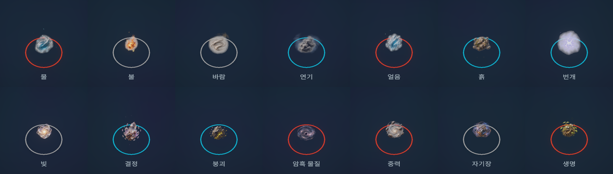
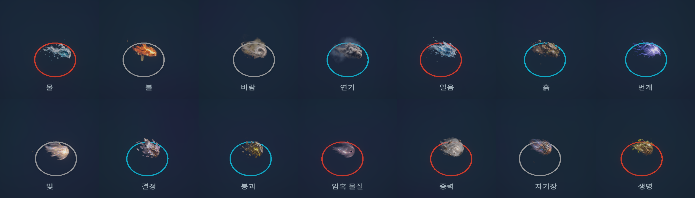
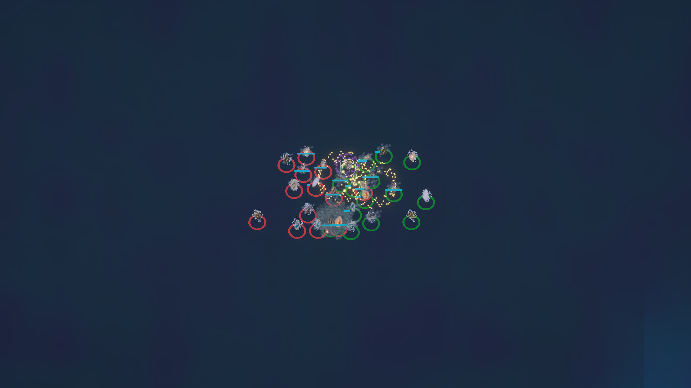

# 승인 시안 기반 원소 표현

이 문서는 2026-11-05의 사진 본체 실험을 기록한다. 현재 프로젝트에는 이후 적용한 [실시간 원소 그래픽](2026-11-06-live-elements.md)을 사용한다.

사용자가 승인한 자연·에너지 14종의 대기·이동 형태를 클라이언트에 적용했다. 본체의 상세 효과 이미지와 실시간 입자·3D 파편을 결합했고 공격·피격·전향·소멸 및 관측 해제 경로를 유지했다. 서버 판정·시야·밸런스는 변경하지 않았다.

## 실제 적용

단순 3D 메시·재질의 실제 Unity 결과가 승인 시안의 질감에 미치지 못해, 최종 본체에는 승인 시안에서 제작한 투명 이미지를 사용한다. 자연 대기·이동, 에너지 대기·이동의 1774×887 RGBA 시트 네 장에 총 28개 상태를 담았다. 원소별 한 개의 인스턴스 배치와 기존 입자층을 재사용하며 유닛마다 GameObject를 만들지 않는다.

- 대기 중에는 응집한 형태가 부유하고 맥동한다. 이동 때는 이동 이미지로 전환하고 화면에 투영한 진행 방향을 향하며 후방 입자를 남긴다.
- 공격·피격·전향 반동은 기존 관측 이벤트에서 재생한다. 확정 공격의 발사체와 소멸 파편, 물방울·불꽃·연기·빛 입자는 실시간으로 그린다. 관측을 잃으면 해당 효과와 이동 기록을 정리한다.
- 흙·이끼·얼음·결정의 3D 표면과 파편, 타워 원소 장식, 발사체 및 빙결·방벽은 기존 메시·재질을 사용한다. 건물은 3D 표현을 유지하고 소유 색상은 건물과 바닥 링에 적용한다.
- 본체의 상세 이미지는 조명·반사 정보가 담긴 카메라 정면의 면이다. 물·연기 전체를 실시간 유체·체적으로 계산하거나 자유로운 모든 시점에서 같은 입체 재질을 제공하는 방식은 아니다. 고정된 RTS 시점에 맞춘 표현이다.

이미지 비율·밝기·낮은 알파 잡음 제거는 머티리얼, 부유·맥동·이동 늘어남·후방 입자 길이와 크기·불투명도는 원소 프로필 인스펙터에서 조절한다. 원본 생성 PNG를 사후 픽셀 편집하지 않았으며 낮은 알파의 여백 잡음은 셰이더에서 제거한다. 입자 상한 32768개와 일회 효과 풀 256개를 유지했다.

## 확인 중 수정한 문제

- 메시를 `CopySerialized`로 갱신하면 CPU의 정점과 실제 GPU 버퍼가 달라지는 사례를 확인했다. GUID를 보존하면서 정점·노멀·탄젠트·UV·색상·삼각형을 명시적으로 갱신하고 GPU에 업로드한다.
- 설치된 불 플립북은 12×6, 연기 플립북은 5×5였다. 가로·세로 프레임 수와 불 프레임의 0.5 종횡비를 본체·공격·피격 풀에 공통 적용한다.
- 사진을 기존 메시 높이에 맞춰 납작하게 만드는 문제를 수정했다. 원본 이미지 비율과 호흡·반동 배율을 사용한다. 불의 기존 큰 보조 화염은 크기·불투명도를 줄였다.
- 일부 이동 속도에서 왼쪽 수평 방향을 지날 때 이미지가 반 바퀴 뒤집히는 문제를 수정했다. 비대칭 색상 이미지를 실제 GPU에서 렌더링하는 회귀 검사로 고정했다.
- 빙결·방벽이 다른 원소의 사진으로 바뀌는 문제를 수정했다. 두 상태는 별도 3D 인스턴스 배치로 유지하고 본체 입자 수에도 섞지 않는다. 4096개체와 ghost 제외 경계를 검사했다.
- 탄젠트가 없는 기존 링·결정 메시의 안전한 셰이더 기저를 추가했다. 소유색은 고유 재질과 구분해 적용한다. 사진 본체는 링 다음 순서에 그려 본체를 가로지르는 선을 줄였다.

## 검증

| 항목 | 결과 |
| --- | --- |
| Unity 클라이언트 EditMode | **61/61 통과**. [기록](Artifacts/element-realism/editmode.json) |
| Unity 셰이더·C# | 최신 코드·테스트가 로드된 상태에서 컴파일 확인. 본체 셰이더 오류 없음 |
| .NET | 소유색 통합 후 전체 **333/333 통과**, Release 빌드 오류 0·경고 0. [소유색 보고](2026-11-05-owner-colors.md) |
| 자산·표시 | 14종·28칸·4개 시트 연결, 알파·비정수 해상도 보존, GPU 이미지 비율·방향·ghost 감쇠·quad 해제·원본 3D 보존 검사 |
| 화면 검토 | 제작자와 별도 검토자가 대기·이동·두 전투 캡처 및 15색 건물·링을 확인 |
| 미실행 | 사람의 Play, Windows Player, 외부망, 연속 애니메이션의 사람 검토 |

시각 검토 범위에서는 검은 사각 배경·과대 사각 파편·다른 원소 사진이 본체 전체를 잘못 덮는 명백한 오류를 발견하지 못했다. 전투 중심부는 유닛과 효과가 겹쳐 일부 가려지며 반투명 가장자리에서는 뒤쪽 링이 보일 수 있다. 정지 캡처 검토를 연속 애니메이션이나 Player 검증으로 간주하지 않는다.

## 같은 조건의 렌더 표본

RTX 3060 Ti, Direct3D11, 1920×1080, Editor의 임시 별도 씬이다. 60회 준비 후 240회 측정했다. CPU 수치는 렌더 제출과 GPU 동기 읽기 대기를 포함한 측정 범위이며 Player 전체 프레임 시간이 아니다. GPU는 해당 카메라 전체 측정 범위다.

| 표본 | 개체 | CPU 범위 p95 | 카메라 GPU p95 |
| --- | ---: | ---: | ---: |
| 작업 전 밀집 | 988 | 18.20ms | 11.04ms |
| 3D 재질·메시 개선 단계 | 988 | 20.52ms | 11.79ms |
| 최종 효과 이미지·입자 밀집 | 988 | **19.53ms** | **10.93ms** |
| 최종 로컬 전투 | 28 | 17.26ms | 9.82ms |

[밀집 기록](Artifacts/element-realism/dense.json), [전투 기록](Artifacts/element-realism/combat.json). 최종 밀집 표본은 입자 7348개, 일회 효과 최대 192개였다. 인위적인 동시 장식 방출 3980건은 기존 상한에 따라 생략됐다. 전투 100틱에서 공격 119회·사망 16회·전향 6회·핵 드롭 10회가 발생했고 장식 생략은 0건, 일회 효과 최대 173개·마지막 입자 1433개였다. Player GC와 60fps 달성 여부는 이 측정으로 판정하지 않는다.

## 실제 Unity 캡처

대기:

이동:

전투:

## 자료와 복구

- 승인 시안·생성 이력: [아트 기록](../Art/Concepts/2026-11-05-realism/README.md), [자연 아틀라스](../Art/Concepts/2026-11-05-realism/baked-atlases.md), [에너지 아틀라스](../Art/Concepts/2026-11-05-realism/energy-baked-atlases.md).
- 설치된 Unity Particle Pack과 Poly Haven CC0의 Rock 08·Mossy Rock·Studio Small 08을 활용했다. [출처·조건](../third-party.md)과 [원본 파일 검증](../Art/Concepts/2026-11-05-realism/material-sources.md)을 남겼다. 조사한 구버전 외부 프로젝트를 통째로 추가하지 않았고 새 런타임 패키지는 없다.
- 원본 자산과 초기 코드 복구본은 `.artifacts/element-realism/before/`에 보존했다. 씬·프리팹 GUID와 기존 소유색·UI·승계 관련 사용자 작업을 유지했다. 캡처용 임시 씬은 닫고 Bootstrap을 복원했다.

소유색 패킷 변경으로 프로토콜은 16이다. 기존 배포본은 클라이언트와 서버를 함께 갱신해야 한다. 이번 작업에서 Windows Player를 새로 배포하거나 실행 중인 외부 서버를 교체하지 않았다.
