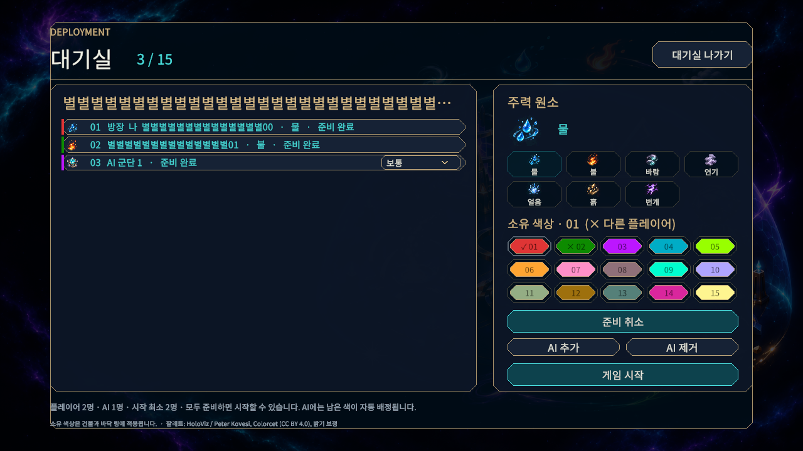
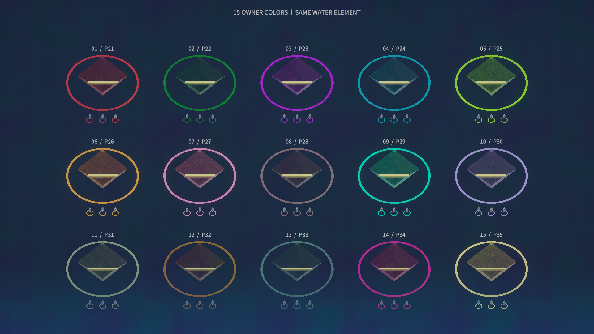

# 대기실 소유 색상

사용자는 대기실에서 자기 색을 선택하고 건물 및 유닛·건물의 바닥 링에 적용하기를 요청했다. 사람끼리 중복 선택을 막고 AI에 남은 색을 배정하는 조건을 확인한 뒤 구현했다.

## 동작

- 15색을 번호와 함께 표시한다. 서버가 확인한 색에만 선택 표시를 하고 다른 사람의 색에는 ×를 표시한다. AI가 사용한 색을 사람이 선택하면 서버가 AI를 빈 색으로 옮긴다.
- 준비 완료·연결 복구 중에는 선택을 잠근다. 시작 이후에는 색을 바꾸지 못한다. LAN·온라인 방에서 같은 규칙을 적용한다.
- 건물·타워 받침·사거리·유닛 및 건물 링·미니맵·플레이어 현황에 소유색을 반영한다. 원소 본체와 타워 원소 장식은 고유색을 유지한다.
- 실제 캡처에서 유닛 링이 가늘어 일부 색을 구별하기 어려운 점을 확인해 외경은 유지하고 안쪽으로 두껍게 했다. `unitRingThickness` 기본값은 외반경의 0.22이며 인스펙터에서 0.06~0.4로 조절한다. 건물 링은 기존 메시를 유지한다.
- 소유자 ID와 팔레트 인덱스를 분리하므로 ID가 15를 넘어도 동작한다. 관측했던 소유색은 세션 동안 기억하고 월드 초기화 시 비운다.

## 서버·저장

서버가 색 범위·중복·준비 상태·권한을 검증한다. 재접속, 월드 저장, 호스트 승계에도 색을 보존한다. 색이 없는 기존 저장은 이미 지정된 색을 우선 예약한 뒤 플레이어 ID 순서로 빈 색을 배정한다. 공개 현황 또는 실제 관측에 필요한 색 정보만 전송하며 숨은 위치·개체를 추가로 공개하지 않는다.

독립 리뷰에서 발견한 승계 후 재입장 충돌도 수정했다. 최초 승계 복구 정보를 연결 시 소비하고 예약 만료 시 해제해, 나중에 재입장할 때 오래된 색이 다시 적용되지 않도록 했다. 두 재현 테스트를 추가했다.

프로토콜은 **16**이다. v15 이하와 호환되지 않으므로 클라이언트와 서버를 함께 갱신해야 한다. Editor의 기본 LAN 서버 후보인 `server/Server/bin/Release/net10.0/`도 새 소스로 빌드했다. 이미 배포한 Player·실행 중인 외부 서버를 자동으로 교체하지 않았다.

## 팔레트·자원

[Colorcet](https://colorcet.holoviz.org/user_guide/Categorical.html)의 `glasbey_light` 앞 15색을 참고하고, 어두운 색만 보정해 `#192B42` 평면 바탕에서 3.2:1 이상의 대비를 확보했다. 원본·커밋·CC BY 4.0 고지는 [제3자 자료](../third-party.md)에 있다. RGB 값은 `shared/Runtime/Data/PlayerPalette.cs` 한 곳에서 관리한다. 숫자·이름·기존 적/중립 마커 형태를 함께 쓰며 모든 색각 조건에서 15색을 구별할 수 있다고 보장하지 않는다.

색별 배치는 128행부터 필요한 만큼 늘리고 프로토콜 개체 상한 안에서 재사용한다. 새 프레임워크·네트워크 패키지는 추가하지 않았다. [Unity DrawMeshInstanced](https://docs.unity.com/en-us/engine/6000.0/script-reference/unityengine/graphics/drawmeshinstanced)의 기존 머티리얼과 프로퍼티 블록을 사용했다.

## 검증

| 항목 | 결과 |
| --- | --- |
| .NET 전체 테스트 | 333/333 통과. [TRX](../../.artifacts/owner-colors/owner-colors.trx) |
| .NET Release 전체 빌드 | 오류 0, 경고 0 |
| Unity 클라이언트 EditMode | 최종 원소 표현을 포함한 61/61 통과. [기록](Artifacts/element-realism/editmode.json) |
| 대기실 | 1280×720, 100%·110%, 최대 15인 및 AI 포함 부분 명단을 캡처하고 제작자와 별도 검토자가 확인 |
| 소유색 | 서버 관측·복제 경로로 15기지·45개 물 유닛·15색을 캡처. 물 본체 고유색 및 건물·링 일치 확인 |
| 사람의 Play·Windows Player·외부망 | 미실행 |

낮은 해상도에서 하단 출처 글씨는 작으며 실제 지형·조명·색각 조건에 따른 최종 식별성은 사람의 Play 확인이 필요하다. 서버 권위와 게임 수치는 이번 작업에서 변경하지 않았다.
