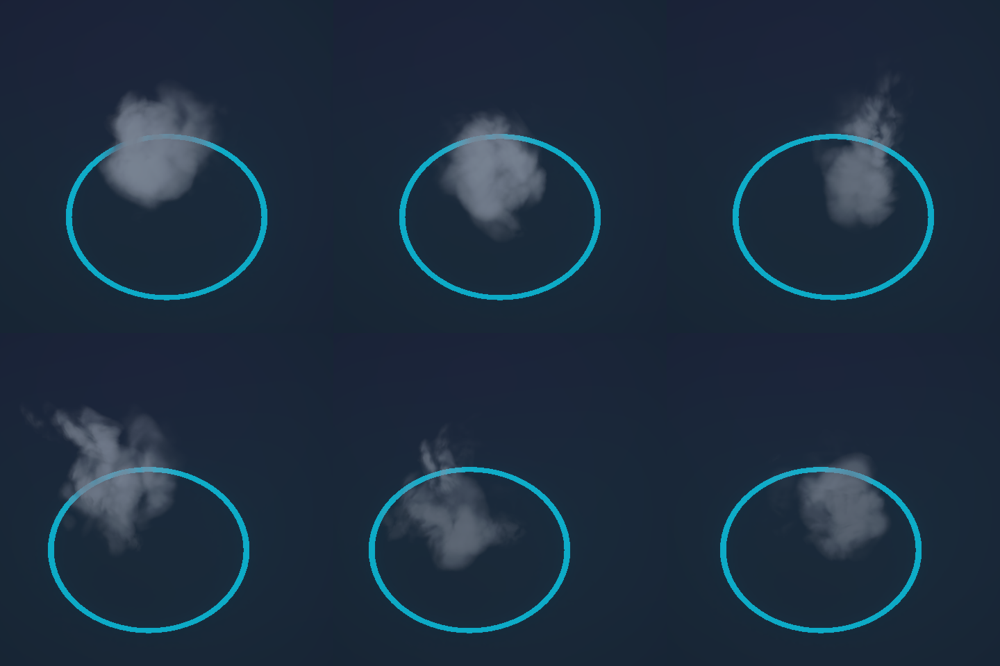

# 실시간 원소 그래픽

사용자가 확정한 대기·이동 형태를 바탕으로 14종 본체를 실시간 입자·셰이더·3D 메시로 구성했다. 기존 사진 본체 셰이더와 재질, 프로필 참조는 프로젝트에서 제거했다. 당시 작업 파일은 `.artifacts/live-elements/before/`에 보관했다.

- 연기는 수명이 다른 입자가 상승·팽창하면서 농도와 윤곽이 달라진다. 큰 덩어리, 중간 입자, 가는 연무가 서로 다른 궤적을 따른다. 불은 불꽃과 잔불을 분리했고, 바람은 가는 3D 소용돌이와 나선으로 흩어지는 먼지를 결합했다.
- 물은 움직이는 표면 노멀과 굴절·반사를 가진 3D 덩어리와 물막이다. 얼음과 결정은 파쇄판과 수정군으로 구분한다. 흙·붕괴·생명은 암석·균열·잎맥의 질감과 깊이를 드러낸다. 번개·빛·암흑 물질·중력·자기장은 시간에 따라 변하는 빛줄기와 파편을 사용한다.
- 기존 관측 이벤트가 공격·피격·전향·소멸 효과를 구동한다. 원소별 입자층과 전투 효과 풀을 재사용하며, 유닛마다 GameObject를 만들지 않는다. 32768개 공용 입자 상한 안에서 본체 입자를 먼저 배정한다. 충분한 수를 배정할 수 없는 밀집 상태와 유령은 가벼운 3D 메시로 표시한다.

2026-11-06에 Unity의 파티클 애니메이션과 URP 소프트 파티클 설정, 공식 VFX Graph 샘플과 VFX Toolbox를 검토했다. 현재 구조에 있는 Particle System 풀과 관측 해제 경로를 그대로 활용하는 편이 통합 범위가 작아, 설치된 Particle Pack의 연기·불꽃 플립북을 개별 입자의 질감에 사용했다. 샘플 저장소의 코드나 추가 패키지는 도입하지 않았다. 표면에는 이미 연결한 Poly Haven의 CC0 암석·이끼·HDR 반사를 사용했다. [Unity 파티클 애니메이션](https://docs.unity.com/en-us/engine/6000.6/manual/visual-effects/particle-systems/configuring-particles/particle-animation) · [Particle Pack](https://assetstore.unity.com/packages/vfx/particles/particle-pack-starter-assets-127325) · [VFX Graph Samples](https://github.com/Unity-Technologies/VisualEffectGraph-Samples) · [VFX Toolbox](https://github.com/Unity-Technologies/VFXToolbox) · [자료 고지](../third-party.md)

Unity EditMode **60/60**, .NET **333/333** 테스트를 통과했다. 연기 입자의 같은 씨앗을 시간별로 비교해 상승과 팽창을 확인했다. 실제 Unity 카메라에서 대기·이동의 14종과 연기 여섯 시점을 캡처했고, Game·Scene 카메라 표시 및 별도 카메라 차단을 재확인했다. [EditMode 기록](Artifacts/live-elements/editmode.json)

988개체 표본의 입자 상한을 64개로 강제해 본체 입자를 한 개도 배정하지 못하는 경우도 렌더링했다. 연기 대체 메시의 화면 중앙 표본 최대 색상값은 알파 보정 전 0.19, 보정 후 0.36이었다. 유령에는 별도 알파 보정을 적용했다.

| Editor 표본 | 개체 | CPU 범위 p95 | 카메라 GPU p95 | 마지막 입자 | 일회 효과 최대 |
| --- | ---: | ---: | ---: | ---: | ---: |
| 밀집 | 988 | 19.77ms | 8.68ms | 9194 | 192 |
| 로컬 전투 | 28 | 18.32ms | 10.84ms | 1537 | 173 |

RTX 3060 Ti, Direct3D11, 1920×1080, 준비 60회와 측정 240회 기준이다. CPU 범위에는 GPU 읽기 대기가 포함된다. 밀집 표본은 인위적인 동시 장식 방출 3980건을 상한에 따라 생략했다. 전투 100틱에서 공격 119회, 사망 16회, 전향 6회, 핵 드롭 10회가 발생했고 장식 생략은 없었다. [밀집 기록](Artifacts/live-elements/dense.json) · [전투 기록](Artifacts/live-elements/combat.json) · [전투 캡처](Artifacts/live-elements/combat.png)

연기 시간 표본은 위 행이 대기, 아래 행이 이동이다. 각 행은 왼쪽부터 시간순이다.

[14종 대기 캡처](Artifacts/live-elements/idle.png) · [14종 이동 캡처](Artifacts/live-elements/moving.png)

전투 중심에서는 효과가 겹치고, 작은 화면에서는 바람의 얇은 흐름과 어두운 에너지 원소의 중심 대비가 약할 수 있다. 시간 표본은 실제 렌더링한 여러 시점이며, 사람의 연속 Play와 Windows Player 검증은 남아 있다.
