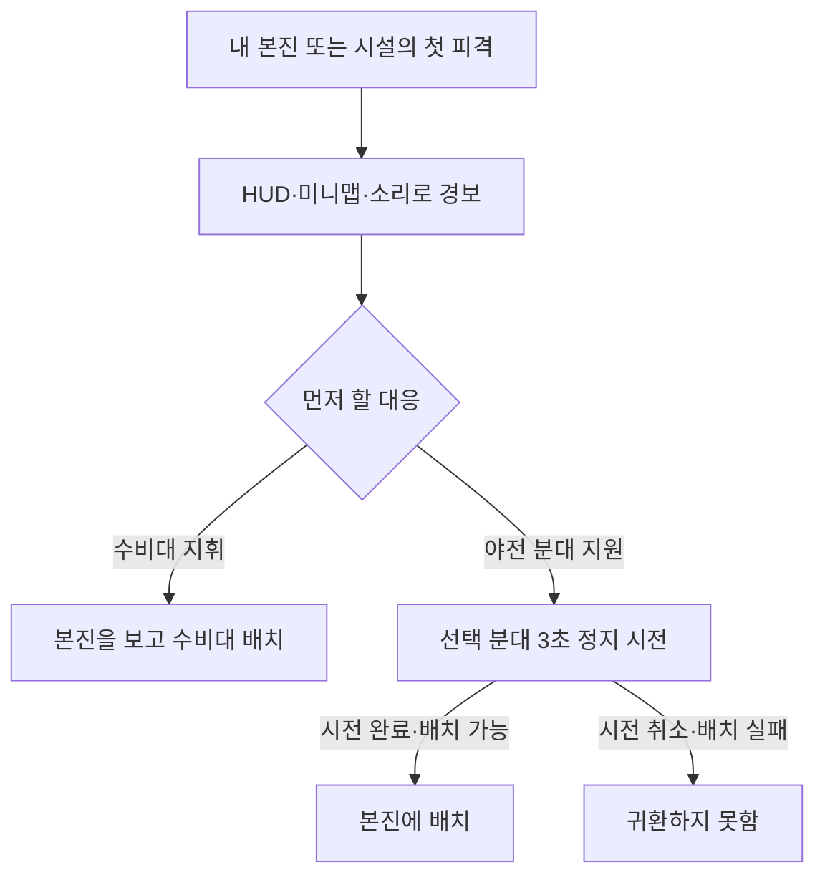

# 기획 설명과 시각화 규칙

게임 기획을 제안하거나 설명·검토할 때 적용한다. 순서, 공간, 선택지, 수치 차이가 설명의 핵심이면 알맞은 그림이나 표를 붙인다. 짧은 문장으로 판단에 필요한 내용을 전달할 수 있으면 그 형식을 쓴다.

## 설명을 시작하는 순서

1. 독자와 판단할 질문을 정한다. 첫 문단에는 누가 어떤 상황에서 무엇을 하고, 그 결과 무엇이 달라지는지 쓴다. 검토받을 결정이 있다면 그 질문도 바로 밝힌다.
2. 먼저 전체 흐름을 보여 주고, 이어서 결정을 바꾸는 조건과 예외를 붙인다. 플레이 설명은 **상황 → 선택 → 피드백 → 결과** 순서로 쓴다. 여러 장면을 다룰 때는 플레이어가 각 단계에서 하는 일과 접하는 화면·알림을 함께 적는다. 실제 관찰을 바탕으로 그린 여정과 새로 제안하는 여정을 표시로 구분한다. [GOV.UK 경험 지도](https://www.gov.uk/service-manual/user-research/creating-an-experience-map)
3. 게임의 판정 규칙, 그 규칙에서 예상하는 플레이 행동, 만들고 싶은 경험을 나눠 쓴다. 예를 들어 관문 두 곳을 지켜야 한다는 규칙에서 병력 분산을 예상한다면, 역전 기회가 늘어나는지는 별도의 플레이 검증 항목으로 둔다. 게임의 규칙·실행 중 행동·플레이 경험을 나눠 보는 MDA를 프로젝트 설명에 적용한 기준이다. [Hunicke·LeBlanc·Zubek의 MDA 원문](https://users.cs.northwestern.edu/~hunicke/pubs/MDA.pdf)
4. 제목이나 캡션에 자료의 상태를 붙인다. `기획 의도`, `현재 기준`, `개편안`, `시험값`은 기획서의 상태 표기를 따른다. 관찰한 결과를 보여 줄 때는 코드 확인·시뮬레이션·실제 플레이 중 어디에서 확인했는지와 측정 조건을 적는다. [기획서 상태 표기](../기획서/분야별/README.md#기준과-상태-표기)

## 질문에 맞는 표현

| 읽는 사람이 확인할 질문 | 표현 방식 | 함께 표시할 내용 |
| --- | --- | --- |
| 한 판이나 첫 플레이가 어떻게 진행되는가? | 타임라인·여정 지도 | 시작과 종료, 주요 시점, 각 단계의 행동·보상·막히는 지점 |
| 새 행동이나 연출이 화면에서 어떻게 느껴지는가? | 장면을 순서대로 그린 스토리보드 | 장면마다 상황, 플레이어가 보는 것, 행동과 반응. 시안과 실제 캡처를 표시한다. |
| 이 선택을 하면 무엇이 달라지는가? | 흐름도·조건표 | 시작 사건, 선택지, 분기 조건, 성공·취소·실패 결과 |
| 언제 다음 상태로 넘어가는가? | 상태도 | 대기·진행·종료 등 상태, 전환을 일으키는 사건, 타이머·복귀 조건 |
| 누가 무엇을 보내고 판정하는가? | 시퀀스 다이어그램 | 플레이어·클라이언트·서버의 순서, 명령·판정·응답, 거부·공개 범위 |
| 어디에서 보고 움직이는가? | 주석을 단 전장 지도·장면 캡처 | 시점, 시작점, 이동 경로, 목표·위험 위치, 방향과 축척. 개념도에는 `축척 없음`을 표시한다. |
| 어떤 원소·시설·설정이 서로 연결되는가? | 관계도·상성표 | 연결의 종류와 방향. 상성표는 행과 열이 공격·방어 중 무엇인지 표시한다. |
| 자원이 어디에서 들어오고 나가는가? | 자원 흐름도·비용표 | 유입, 소비, 축적, 상한, 발생 조건과 단위 |
| 어떤 안을 선택해야 하는가? | 같은 기준으로 나란히 놓은 비교표 | 안별 플레이 차이, 이득, 부담, 미확인 항목. 같은 상황과 비교 단위를 사용한다. |
| 값이 얼마나 다르고 시간에 따라 어떻게 바뀌는가? | 크기 비교는 막대, 시간 변화는 선, 분포는 점도표·히스토그램, 정확한 값은 표 | 단위, 축·기준선, 비교 조건, 표본 수, 출처와 측정 상태 |
| 화면·아트·사운드가 어떤 정보를 전달하는가? | 주석을 단 캡처·화면 배치 초안·효과음 조건표 | 시선이 닿는 위치, 입력과 화면 반응, 소리의 발생 조건·위치·우선순위. 반응 속도가 핵심이면 짧은 영상이나 조작 가능한 시안을 쓴다. |

정량 자료의 형식은 먼저 비교할 관계를 정한 뒤 고른다. 익숙한 형식으로 핵심 비교를 드러내고, 다른 질문은 필요한 만큼 별도 그림으로 뺀다. [영국 통계청 차트 선택](https://service-manual.ons.gov.uk/data-visualisation/chart-types/choosing-a-chart-type)

## 그림과 수치를 표시하는 방법

- 그림 하나에 질문 하나를 둔다. 제목으로 요점을 짚고, 관련 없는 장식과 세부 단계는 걷어낸다. 조건이나 설명은 해당 화살표·표식 가까이에 둔다. 복잡한 규칙은 전체 흐름을 보여 준 뒤 상세 그림으로 연결한다. [Fiorella·Mayer의 멀티미디어 학습 원칙](https://www.cambridge.org/core/books/abs/cambridge-handbook-of-multimedia-learning/principles-for-reducing-extraneous-processing-in-multimedia-learning/F29A19FCD34C542806F736E0661C05F5)
- 화살표가 시간 순서, 상태 전환, 원인, 이동 중 무엇을 뜻하는지 그림 안에서 읽히게 한다. 같은 역할에는 같은 이름과 표식을 쓰고, 소유자·위험·상태는 색 외에도 글자, 모양, 선 모양으로 구분한다. [W3C 색 사용 기준](https://www.w3.org/WAI/WCAG22/Understanding/use-of-color.html)
- 그림 바로 옆에 핵심 결과와 중요한 조건을 문장으로 적는다. 복잡한 지도·차트는 필요한 경로·값·비교 결과를 본문이나 표로도 제공한다. 이미지에는 내용을 설명하는 대체 텍스트를, Mermaid에는 `accTitle`과 `accDescr`을 넣는다. [W3C 복잡한 이미지](https://www.w3.org/WAI/tutorials/images/complex/) · [Mermaid 접근성](https://mermaid.js.org/config/accessibility.html)
- 막대는 0을 공통 기준선으로 삼는다. 비교하는 그림은 같은 단위와 축을 쓰고, 선 그래프에서 범위를 좁힐 때는 실제 축 범위를 표시한다. 백분율에는 분모를 적고, 목표·시험값·측정값을 범례나 열로 구별한다. 시뮬레이션과 사람의 플레이 결과에는 각각의 조건을 붙인다. [영국 통계청 축과 눈금](https://service-manual.ons.gov.uk/data-visualisation/guidance/axes-and-gridlines)
- 전후 캡처는 비교할 항목에 맞춰 카메라, 축척, 해상도, 게임 상태를 맞춘다. 바뀐 부분에 주석을 달고, 시안·실행 화면에는 각각 상태를 표시한다. 외부 이미지·영상은 출처와 이용 조건을 확인한 범위에서 활용한다. [외부 자료 규칙](reuse.md)
- 저장소의 작은 정적 흐름도·상태도·시퀀스는 Mermaid로 작성한다. 배치나 외형이 판단에 중요하면 지도나 실제 화면을 쓴다. [Mermaid 흐름도 문법](https://mermaid.js.org/syntax/flowchart.html)

## 예시 — 본진 경보를 받고 어떻게 대응하는가

**개편안·시험값.** 원정 중인 플레이어가 본진 경보를 받은 뒤 수비대를 지휘하거나 선택한 야전 분대를 귀환시키는 흐름이다. [본진 경보와 긴급 귀환](../기획서/분야별/03-systems.md#본진-경보와-긴급-귀환)

본진이나 시설의 첫 피해에 경보가 뜬다. 플레이어는 본진을 보고 수비대를 배치하거나 야전 분대에 귀환을 명령한다. 시전 중 선택 분대가 적의 피해를 받거나 이동 명령을 수행하면 시전이 취소된다. 시전을 마쳐도 본진이 무력화됐거나 배치 공간이 부족하면 귀환하지 못한다.

플레이테스트에서는 첫 피해부터 경보 인지·첫 조작·수비 개입까지의 시간을 기록하고, 귀환 실패가 화면에서 구분되는지 확인한다. [본진 습격 검증 절차](../기획서/분야별/12-playtest.md#개편안-검증-순서)

## 검토

- 처음 보는 사람이 자료만 읽고 누가 무엇을 보고 선택하는지, 성공과 실패의 조건은 무엇인지 설명할 수 있는지 확인한다. 막히는 지점에 조건이나 표식을 보강한다.
- 원본 기획·수치·캡처와 대조해 상태, 용어, 단위, 분기 조건, 출처를 확인한다. 예상한 행동과 관찰한 행동을 구분한다.
- 전달할 뷰어와 화면 크기에서 그림을 열어 글자 크기·잘림·화살표·범례를 본다. 그림이 표시되지 않는 곳에서도 본문의 문장과 표로 핵심 판단을 할 수 있어야 한다.
