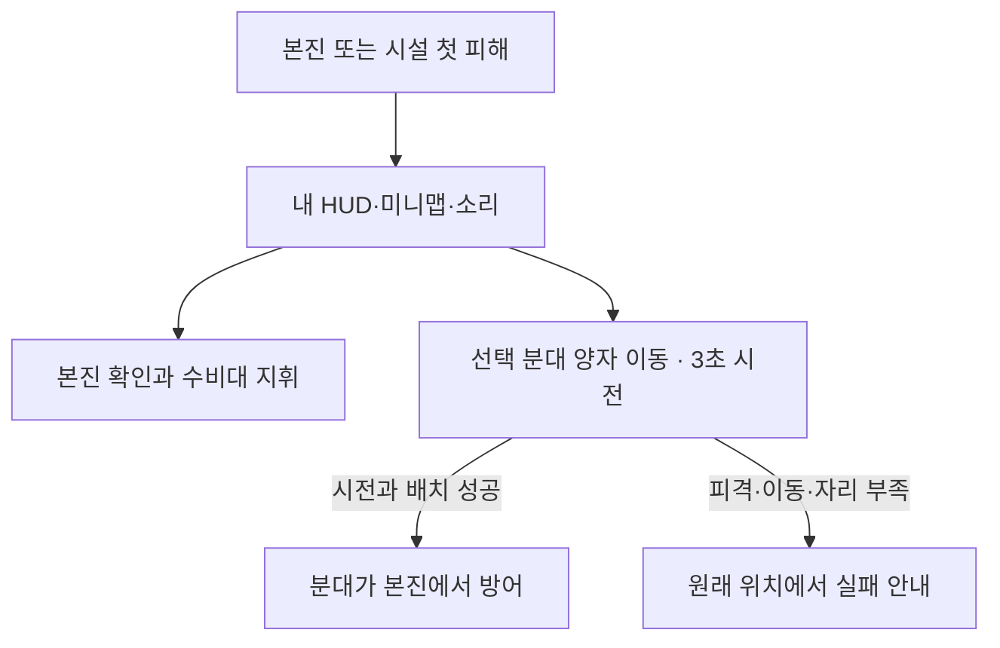

# Elemental Legion 메인 게임 개선안

2026-11-06 · 기획 제안과 시험값

[구현 계획](../Plans/2026-11-09-main-world-improvement.md)에서 단계별 변경 범위·의존성·검증 기준과 구현 전 결정 항목을 확인한다.

2026-11-09에 구현 계획의 [상세 결정 D1~D7](../Plans/2026-11-09-main-world-improvement.md#승인된-결정)을 승인받았다. 분대의 선택과 카메라 전환 방식은 조작 검토에서 구체화한다.

원정에 나간 플레이어는 본진이나 시설이 공격받으면 바로 알고, 남겨 둔 수비대를 움직이거나 **양자 이동**으로 야전 분대 하나를 본진에 귀환시킨다. 교전에서 이긴 쪽은 도망가는 적을 추격할지 남아서 전향 병력을 확보할지 고른다. 밀린 쪽도 남겨 둔 분대로 측면을 돌아 아군을 구출하거나, 상대가 비운 생산시설을 노릴 수 있다.

이 흐름을 일반 서버의 **상시 월드**에 적용하는 안이다. 원소 전향, 자유 입퇴장, 본진 투자와 본진 파괴에 따른 개인 패배를 기초로 삼는다. **근원 쟁탈전은 보류 중인 별도 모드 후보**다. 일반 LAN·인터넷 방은 해당 방의 승패·저장·승계와 호환되는지 확인한 뒤 적용 범위를 정한다. [별도 모드와 현행 분야별 기획](분야별/README.md) · [패널 비교](#의사결정-패널-기록)

## 플레이 흐름

| 상황 | 플레이어의 선택 | 화면과 결과 |
| --- | --- | --- |
| 첫 입장과 0~3분 | 야전 원소로 가까운 핵이나 자연 중립을 찾고, 수비대는 본진에 둔다. 응집로를 먼저 지어 원소를 늘리거나 포집기·수호 위성에 먼저 투자한다. | 습득한 핵은 바로 쓸 수 있다. 중립 전향은 즉시 합류한다. 첫 보상은 20초 이내, 첫 시설 선택은 90초 안팎을 시험한다. |
| 원정과 성장 | 야전 분대를 나눠 한 곳에서 자원을 얻고 다른 곳을 정찰한다. 교전을 고르면 둘을 모으고, 본진에는 수비대를 남긴다. | 분대별 병력과 목적지가 보인다. 양성된 증원은 본진에서 해당 분대로 실제 이동해 합류한다. |
| 본진 습격 | 첫 피격을 보고 수비대를 옮기거나 전투 중이 아닌 분대에 양자 이동을 시전한다. 공격자는 전방 분대의 시전을 끊거나 먼저 외곽 시설을 부순다. | 방어자는 어디가 피해를 받았고 양자 이동이 왜 중단됐는지 안다. 공격자는 본진을 깨지 못해도 생산·수급을 늦추는 성과를 낼 수 있다. |
| PvP 교전 종료 | 이긴 쪽은 전향 후보 확보와 추격 중 하나에 병력을 더 쓴다. 밀린 쪽은 구출·외곽 습격·다른 중립 경로 중 하나를 택한다. | 짧은 교전 기록에 확보, 구출, 손실, 얻은 핵과 시설 결과가 남는다. |
| 패배 또는 이탈 | 본진이 무너지면 손익을 본 뒤 같은 서버의 새 입장을 고른다. 자발적 이탈·단절 뒤에는 살아 있는 유령 자산으로 복귀할 수 있다. | 개인의 여정은 끝나거나 멈추고 월드는 계속된다. 순위와 기록은 현재 세력과 이번 여정의 결과를 나눠 보여 준다. |

작은 수집이 바로 성장으로 이어지고, 병력을 나눌수록 더 많은 곳을 노리면서 빈 곳을 드러내는 구조를 사용한다. 마지막에 위험을 감수할지는 전향 후보를 지키거나 상대의 빈 경로를 끊는 선택에서 결정한다. 재도전 의사는 사람 플레이에서 확인할 가설이다. [.io 사례와 공식 출처](분야별/14-io-references.md)

## 현재 기준과 개선 이유

| 현재 기준 | 플레이에서 확인할 문제 |
| --- | --- |
| 3기·0핵, 한 번에 1기 양성 | 첫 투자 전까지 선택이 적고 큰 군단을 보려면 성장 시간이 길다. |
| 레벨별 20/30/40/50기, 야전 중심 하나, G로 수비대 집결 | 원정·엄호·수비를 각자 배치할 조작 단위가 없다. |
| 1,680m 월드, 본진 최소 간격 300m, 이동 7m/s | 최소 간격도 직선 약 43초다. 실제 15자리 후보 격자의 가까운 간격은 336m로 약 48초다. |
| 본진 2,000HP, PvP 전향 60%·중립 80%, 합류 체력 100% | 병력이 많아지면 만피 본진도 빠르게 무너질 수 있다. 교전 승자는 즉시 건강한 병력을 얻어 다음 전투에 투입한다. |
| 본진 파괴로 개인 패배, 동일 계정은 살아 있는 유령으로 복귀 | 월드는 계속되지만, 플레이어가 싸움을 끝내고 손익과 다음 행동을 읽는 경험은 더 다듬을 수 있다. |

기준은 작업공간의 데이터와 기존 코드에서 확인했다. 불편의 체감과 전투 지속 시간은 실제 플레이에서 비교할 가설이다. [기획 요약](../design-summary.md) · [게임 규칙](../Rules/gameplay.md) · [게임 데이터](../../shared/Data/gamedata.json) · [입장 격자](../../shared/Runtime/Sim/WorldEcology.cs)

## 군단 조작과 본진 방어

**분대 지휘.** 야전 1~3번과 본진 수비대 4번을 사용한다. 시작할 때 야전 1번에 8기, 수비대에 4기를 둔다. 본진 반경 안에서 기존 병력을 다른 분대나 수비대로 옮기거나 양성 목적지를 지정해 새 분대를 꾸린다. 방향키·WASD는 선택 부대를 직접 움직인다. 전장 우클릭은 이동 후 해당 위치를 사수하게 하고, 전체 선택은 야전 분대만 함께 움직인다. 다른 부대는 직전의 이동·대기 명령을 이어 간다. 수비대는 본진 반경 25m 안에서 배치하고, G는 지정한 수만 선택 야전 분대로 보낸다. 출격이나 양성에서 목적 분대에 인구를 한 번 예약한다. 합류 전에는 전투·손실이 가능하고 야전 분대 시너지에는 포함하지 않는다.

**본진 경보.** 본진이나 소유 시설의 첫 피해를 소유자 HUD·미니맵·소리로 알린다. 같은 본진 구역의 반복 경보는 5초 간격으로 묶는다. B는 선택을 유지하면서 본진으로 시점을 옮기고, 4는 수비대를 선택한다. 수비대가 있으면 현장에서 곧바로 대응할 수 있다. 외곽 시설을 먼저 잃으면 생산·수급이 끊길 수 있어, 방어자가 타워·시설 위치와 남길 병력을 고르는 이유가 생긴다.

### 양자 이동

**개편안 · 명칭과 세계관.** 2026-11-09 사용자 제안을 반영해 귀환 스킬의 이름을 **양자 이동**으로 제안한다. 원시핵은 자신에게 속한 원소들과 고유한 양자 연결을 유지한다는 설정이다. 선택한 분대가 이 연결을 맞추면 원시핵 곁으로 이동한다. 첫 입장부터 사용할 수 있는 원시핵의 기본 스킬로 두어, 어떤 원소를 골라도 본진 습격에 대응할 수 있게 한다. 기존 설정의 ‘궤도 복귀’에 해당하는 메인 게임 개편 명칭이다. [세계관과 행동의 연결](분야별/07-world-narrative.md#메인-게임-개편안--양자-이동)

**시전과 판정.** R로 합류한 야전 분대 하나에 양자 이동을 시전한다. 3초 동안 정지해 연결을 맞추며, 피격이나 이동 입력으로 연결이 흐트러지면 끊긴다. 목적지는 자기 원시핵 주변의 귀환 구역이다. 서버는 완료 틱에 살아 있는 본진과 건설 금지로 예약한 귀환 구역의 빈 슬롯을 검사해 생존 분대원 전원을 함께 옮긴다. 성공 시 원시핵이 연결을 다시 안정시키는 60초 동안 모든 분대가 공유하는 대기시간을 적용하며 체력은 그대로다. 한 플레이어는 한 번에 한 분대만 시전할 수 있다. 실패하면 원래 위치에서 이유를 확인한다. 귀환 구역에는 다른 병력도 진입할 수 있다.



**공성 대응 시간.** 본진 2,000HP를 대상으로 **모든 공격자의 합산 피해를 초당 250HP로 제한**하는 시험군을 둔다. 자기권이 흡수한 뒤 본진 체력에 들어가는 피해만 제한하며 외곽 시설과 자기권 직접 공격은 일반 규칙을 따른다. 20Hz에서 틱당 최대 12.5HP를 적용하면 만피에서 파괴까지 최소 160번의 피해 틱, 약 8초가 필요하다. 빛 100기가 전부 유효 타격한다는 단순 가정에서는 기존 명목 화력 1,500HP/초로 약 1.33초다. 손상된 본진은 남은 체력만큼 대응 시간도 짧아진다. 대군의 추가 병력이 수비 제거·외곽 시설 파괴·퇴로 차단에 여전히 가치가 있는지 함께 시험한다. [현행 공성 판정](../../shared/Runtime/Sim/SiegeSystem.cs) · [현행 원소 수치](분야별/09-balance.md#원소-기본-전투-수치)

## 전향 확보와 반격

**중립은 즉시 전향한다.** 현행 전향 확률 80%와 합류 체력을 첫 시험의 기준으로 삼는다. 새 입장이나 패배 뒤에는 가까운 자연 중립으로 다시 성장할 수 있다. 핵도 습득 즉시 잔고에 반영한다.

**PvP에서만 전향 후보가 남는다.** 전향 추첨 60%에 성공하고 막타 소유자에게 슬롯이 있으면, 쓰러진 원소는 최대 20초 동안 확보 또는 구출 대상이 된다. 막타를 낸 분대의 생존 원소가 반경 5m 안에서 적과 경합하지 않는 시간을 3초 쌓으면 50% 체력으로 전향시킨다. 직전 소유자의 분대도 같은 조건에서 25% 체력으로 구출할 수 있다. 구출은 원소 한 기당 한 번이며, 여러 분대가 조건을 채우면 가장 가까운 생존 원소의 분대로 돌려보낸다. 거리가 같으면 분대 번호순이다. 적이 반경 안에 들어오면 진행을 멈추고, 자기 원소가 범위를 벗어나면 그쪽 진행을 초기화한다. 결과는 전향, 구출, 만료 핵 전환 중 하나다. 재전향·타워 처치·인구 부족은 기존 드롭 규칙을 따른다.

전향 후보는 막타 소유자의 인구와 전역 유닛 예산에 한 번 예약한다. 구출 완료 때는 직전 소유자의 빈 슬롯을 다시 검사하고 예약을 넘긴다. 예약이 남아 있는 동안 양성·전향이 같은 슬롯을 사용할 수 없다. 서버는 해당 틱의 이동·사망·탈락을 적용한 뒤 진행을 확인한다. 만료 틱에는 핵 전환이 우선이고, 확정 결과에서만 예약을 반영하거나 해제한다. 활동 중인 소유자만 확보·구출을 진행한다. 단절 중에도 만료는 흐른다. 관측 대상은 주변 원소·시설의 서버 시야를 따르고, 진행 중단 표시로 시야 밖의 방해자 신원이나 위치를 알려 주지 않는다.

**40기 대 80기 예시.** 열세 측은 병력을 주력 28기와 측면대 12기로 배치한다. 주력에서 손실이 나면 살아남은 원소를 물린다. 우세 측이 모든 병력으로 추격하면 측면대는 비어 있는 교전지로 돌아가 아군 구출을 시도한다. 우세 측이 회수대를 남겨 구출을 막으면, 열세 측은 상대의 포집기나 다른 중립 경로를 노린다. 3초 확보를 빼면 접근 시간은 최대 17초다. 기본 이동 속도로 직선 119m라는 산술값이므로, 실제 시도는 미리 가까이 남겨 둔 분대가 맡는다.

교전 요약에는 확정된 전향·구출·손실·핵·시설을 표시한다. 본진 파괴는 개인 패배로 끝나고 새 입장을 선택한다. 서버 세력 현황은 본진을 제외한 완공 시설당 10점, 본진 레벨당 25점, 생존 원소당 2점으로 현재 상태를 비교하는 시험안을 둔다. 누적 공성 승리는 개인 여정 기록에서 읽는다. [현행 순위와 유령](../Rules/gameplay.md) · [현행 모드](분야별/05-modes.md#현행-규칙)

## 레벨과 경제 시험값

첫 시험은 **1,680m와 기존 입장 격자**를 사용한다. 새로 만든 시험 월드에서 초반 자원과 중립의 위치를 바꾸고, 이미 저장된 본진·시설은 좌표를 유지한다. 적을 만날 기회는 본진 간격만으로 조절하지 않고 가까운 사냥 경로와 인접 자리 사이의 공용 경로를 따로 둔다.

```text
개념도 · 축척 없음. 선은 이동 경로를 뜻한다.

[내 본진] ─ [첫 핵과 자연 중립] ─ [공용 자원 길] ─ [이웃 본진]
                     │                 │
               [가까운 재정비 경로]   [중앙 에너지 중립]
```

첫 핵은 시작 위치에서 20~35m, 첫 자연 무리는 35~70m, 다음 무리 간 직선 거리는 70~140m를 시험한다. 이동 속도 7m/s로 계산하면 첫 핵까지 약 3~5초, 첫 자연 무리까지 5~10초, 다음 무리까지 10~20초다. 인접 본진 사이 공용 경로의 중간은 각 본진에서 직선 168m로 약 24초다. 자동 교전 거리·시설 경계를 확인하고 양쪽에서 접근할 수 있는 공용 자리를 고른다. 최초 자원은 해당 자리의 공급 한도에 포함하고 공급 주기는 자리 기준으로 유지한다. 기하 시간에는 교전·우회·진형 재편이 포함되지 않는다. [현행 전장](분야별/06-level-design.md#현행과-비교)

| 수치 | 현행 기준 | 첫 시험값과 확인할 이유 |
| --- | --- | --- |
| 시작 원소와 핵 | 3기·0핵 | 주력 자연 12기·0핵. 야전 8기와 수비대 4기. 첫 분대를 배치하는 경험과 초반 교전 난이도를 비교한다. |
| 레벨별 총 인구 | 20/30/40/50기 | 30/50/75/100기. 수비대는 그 안에서 8/12/16/20기. 야전 분대는 남은 인구를 나눠 쓴다. |
| 양성 | 순차 1기 | 최대 4기 묶음 예약 후 순차 양성. 기당 주력 8핵·6초, 일반 자연 10핵·8초, 에너지 17핵·13.6초를 비교 기준으로 둔다. |
| 첫 투자·성장 | 포집기 20, 응집로 30, 타워 40핵. 업그레이드 45/70/95핵 | 가격을 유지하고 접근 시간부터 줄인다. 본진 수비대를 출격시키면 대기 병력이 줄어든다. |
| 맵 핵과 중립 | 맵 핵 20개/인/분, 일반 중립 재생성 300초 | 총공급과 재생성은 고정한다. 신규 배치에서 핵은 4개씩 분당 5묶음, 가까운 쪽 3묶음과 공용 쪽 2묶음을 시험한다. |
| PvP 보상 | 전향 60%, 합류 체력 100% | 추첨률은 유지하고 20초 안에 3초 확보, 전향 체력 50%·구출 체력 25%. 일반 미전향 드롭은 자연 5·에너지 8핵. 핵과 병력 격차를 함께 잰다. |
| 본진 대응 | 2,000HP, 즉시 적용되는 시설 피해 | 본진만 합산 초당 250HP 상한 시험. 3초 귀환·공용 60초와 함께 2~4인에서 방어와 공성 양쪽을 확인한다. |

**성장 산술 예시.** 3분 동안 가까운 핵 전부와 공용 핵 절반을 확보하면 맵에서 48핵이다. 자연 중립 8기 중 6기가 전향되고 나머지 둘의 10핵을 주웠다면 총 58핵이다. 응집로 30핵과 주력 3기 24핵을 쓰고 2기를 잃으면 19기와 4핵이 남는다. 이 수치는 수집과 교전에 성공한 사례다. 실제 3·10·25분 인구와 다음 목표까지 걸린 시간을 기록하며, 100기는 성장 속도와 밀집 조작을 확인할 상한이다. [현행 비용과 성장](분야별/08-economy-progression.md)

## 원소·시설과 세계관

| 검토 범위 | 개선안에서 맡는 역할 |
| --- | --- |
| 자연 원소 | 흙은 전열, 얼음은 공격 속도 제어, 불은 화상, 연기는 사거리 압박, 물은 젖음 연계, 바람은 빠른 연사, 번개는 연쇄 공격이다. 입장 안내는 주력 원소와 가까운 보조 원소 조합을 한 번만 보여 준다. |
| 에너지 원소 | 암흑 물질은 흡혈, 자기장은 방벽, 결정은 공격 속도 지원, 중력은 광역, 빛은 관통, 붕괴는 지속 피해, 생명은 회복이다. 중앙 원정을 가거나 점화로를 지어 얻는 질적 성장이다. 밀집전에서는 중력·빛·회복이 특정 조합을 강제하는지 별도로 본다. |
| 시너지 6종 | 감전·빙결·증기·화염 확산·모래폭풍·플라즈마 폭발을 유지한다. 여러 분대가 시야에 들어와도 공명 계산은 같은 야전 분대에서 일어나며, 상태의 출처는 부여 당시 분대에 고정한다. |
| 시설 6종 | 원시핵은 개인 여정, 포집기는 가까운 수급, 응집로·점화로는 자연·에너지 양성, 수호 위성과 자기권은 방어 투자다. 개별 시설을 먼저 부수면 생산·수급·보호를 약화시킬 수 있다. |
| 세계관 | 별의 씨앗은 원소를 끌어모은다. 교전 뒤 힘이 약해진 원소를 확보하는 장면은 강착으로, 원시핵과 연결을 맞춰 귀환하는 스킬은 양자 이동으로 표현한다. 본진을 잃고 새로 입장하는 일은 재탄생, 접속이 끊긴 본진은 표류 행성으로 읽힌다. |

수치 비교에서는 기본 상성 배율과 원소별 능력치를 먼저 고정한다. 120기 시험에서 광역 적중 수, 회복으로 버티는 시간, 주요 조합별 승률을 기록한 뒤 영향이 확인된 항목을 조정한다. [원소·시너지·시설](분야별/04-content.md) · [세계관](분야별/07-world-narrative.md) · [현행 능력치](분야별/09-balance.md#원소-기본-전투-수치)

## 화면·학습·연출

- HUD에서 핵 잔고, 양성 예약, 분대별 인원·목적지, 수비 상태를 바로 읽을 수 있게 한다. 미니맵 좌클릭과 좌드래그는 시점을 옮긴다. 전장과 미니맵의 우클릭과 우드래그는 선택 부대에 지점 이동을 지시한다. 건설 중 우클릭은 배치 취소가 우선이다.
- 본진 경보는 HUD와 미니맵의 같은 자기 본진 표지를 강조한다. 경보에서 시점을 옮기고 수비대를 지휘할 수 있게 연결한다. 공격자와 사유는 서버가 관측을 허용한 범위에서만 안내한다.
- 스킬 버튼은 **양자 이동 · 본진 귀환 [R]**으로 표기한다. 선택 분대의 시전 진행, 취소·실패 상태, 원시핵이 공유하는 재사용 대기를 소유자에게 보여 준다. 시전 중에는 분대 주변의 고리가 모이고, 완료되면 본진 귀환 구역에 같은 무늬의 고리가 펼쳐지도록 제안한다. 적에게는 현재 시야 안에서 서버가 허용한 장면만 표현한다.
- 첫 플레이에서는 이동과 즉시 보상, 한 번의 양성, 분대 이동을 차례대로 익힌다. 경보와 양자 이동은 실제로 위험이 생기거나 연습 상황을 열었을 때 알려 준다. 안내 문구는 ‘원시핵이 공격받고 있습니다. 분대를 선택하고 R로 양자 이동하십시오.’로 제안한다.
- 원소 자체는 고유 형상·색을, 소유자와 분대는 바닥 링·번호·윤곽을 쓴다. 대군에서 개별 상태가 겹치면 선택 분대와 즉시 대응할 표식을 우선한다. 본진 경보음은 전투 효과보다 먼저 들리며 같은 구역의 피해를 묶는다. 소리를 꺼도 같은 상태를 읽을 수 있다.

### 조합키 안내와 미니맵

**UI 후속 기획 · 2026-11-11.** 전투 중 다른 분대에 병력을 보내면, 하단 분대 표시에서 조합을 읽고 미니맵에서 분대 위치와 움직이는 원소를 확인한다.

| 표시 | 동작 |
| --- | --- |
| 조합키 안내 | 첫 번호키를 누르는 동안 하단에서 출발 분대를 강조한다. 둘째 번호키를 누르면 `4 → 2 · 3기 출격 요청`처럼 방향과 요청 수량을 잠깐 표시한다. 명령 결과와 이동 상태는 서버가 알려 준 내용을 표시한다. |
| 분대 번호 | 내 야전 분대 `1`~`3`과 수비대 `4`의 서버 관측 위치에 번호를 놓는다. 선택한 분대에는 테두리를 두르고, 가까운 표식은 `1·4`처럼 모아 읽을 수 있게 한다. `5`는 하단의 야전 전체 선택에 사용한다. |
| 이동 중인 원소 | 미니맵에 표시할 수 있는 원소가 움직이면 작은 점의 밝기를 천천히 바꾼다. 정지하면 일반 표식으로 돌아간다. 연속으로 받은 서버 위치로 이동을 확인하고, 적과 중립은 현재 시야 규칙을 따른다. 분대 번호는 점 위에 그려 계속 읽을 수 있게 한다. |

예를 들어 1번을 조종하면서 `4`를 누른 채 `2`를 누르면, 조합 안내에서 목적지를 확인하고 미니맵에서 2번의 위치와 걸어가는 원소의 점을 함께 볼 수 있다. 첫 시안에서는 본진 주변에 번호가 모이는 상황과 여러 부대가 동시에 움직이는 상황에서 번호와 점을 구분할 수 있는지 확인한다.

[현행 화면과 조작](분야별/10-ui-ux.md) · [아트·사운드](분야별/11-art-audio.md) · [시각 검증 기록](../Reports/2026-11-06-live-elements.md)

## 운영과 데이터

- 동일 계정은 유령 자산이 살아 있는 최대 600초 동안 같은 월드로 복귀한다. 접속을 반복해도 시작 원소·핵·재사용 대기나 전투 기록을 다시 만들 수 없게 한다. 복귀가 끝난 뒤 새 입장은 안전한 자리와 새 여정으로 처리한다.
- 서버가 분대 소유권, 유한한 좌표·범위, 인구, 시간과 자원을 검증한다. 명령 수신자는 세션의 인증된 소유자다. 카메라 전환과 재접속 응답은 숨은 적의 좌표·시설·실패 원인을 공개하지 않는다. 과거 연결과 중복 명령은 한 번만 처리한다.
- 현행 저장은 데이터 해시가 다르면 복원을 거부한다. 별도 시험 월드와 저장 경로에서 검증하고, 운영에 적용할 때는 기존 파일의 백업과 변환 검사를 거친다. 소유자·위치·체력·잔고·대기열·유령 만료 시각을 보존하고 옛 야전 군단은 첫 분대로 매핑한다. 시험값으로 바꾼 파일에 기존 저장을 덮어쓰는 순서는 금지한다.
- 전투 결과와 외형·칭호는 여정 기록으로 쓴다. 개인 기록이나 순위에 다음 입장의 능력치 보상을 붙이지 않는다. 일반 LAN·인터넷 방은 인원별 전장, AI 승패, 저장·호스트 승계까지 별도 호환 검증한 뒤 적용한다.

[보안 규칙](../Rules/security.md) · [월드 복원과 데이터 해시](../../shared/Runtime/Sim/WorldCheckpoint.cs) · [라이브 운영](분야별/13-live-operations.md)

무료 시작 원소는 새 여정에서 한 번 부여하고, 새 입장에 적용되는 현행 30초 보호와 해제 규칙을 비교 기준으로 둔다. 복귀한 자산에는 보호 시간과 시작 병력을 다시 지급하지 않는다. 무료 시작 원소의 표지를 저장하고 PvP 사망·유령 만료 시 해당 원소에서 전향·구출·핵 보상이 생기지 않는 시험군을 둔다. 새 입장에 지급한 원시핵도 이 시험군에서는 유령 만료 시 시설 정액 핵 지급에서 제외한다. 정규 양성·전향으로 얻은 원소와 기존 저장 원소는 일반 규칙을 사용한다. 같은 계정의 재입장이나 부계정 협공으로 무료 자산을 반복 수확할 수 있는지 확인한다. [현행 유령 정리](../../shared/Runtime/Sim/PlayerLifecycle.cs)

시험용 AI는 플레이어와 같은 관측과 명령을 사용한다. 자연 원소 사냥과 분대 합류부터 재현하고, 난이도별 공성 대응과 경보 흐름은 사람 조작 결과와 나눠 평가한다. [현행 AI](../Rules/architecture.md#봇)

## 검증 순서와 채택 기준

| 단계 | 확인할 상황과 기록 | 판단 기준 |
| --- | --- | --- |
| 2~4인 · 시작과 배치 | 같은 시드에서 현행 3기와 시험 12기로 첫 보상, 첫 시설, 분대 배치, 3·10분 인구를 비교한다. | 첫 보상 20초 이내, 첫 시설 선택 90초 안팎을 시험한다. 시작 병력이 늘어도 분대 선택을 못 하거나 첫 위험이 급해지면 지급 구성과 배치를 다시 본다. |
| 2~4인 · 방어와 공성 | 시설부터 공격, 다수 동시 본진 공격, 귀환 분대 피격, 귀환 구역 점유를 비교한다. | 일반 연결에서 첫 경보 1초 안팎, 시전 가능한 분대가 약 5초 안에 개입하는지 잰다. 대군의 외곽 시설 공격과 퇴로 차단이 실질적 이득이어야 피해 제한을 채택한다. |
| 2~4인 · 교전 뒤 반격 | 40기 대 80기에서 승자가 추격 또는 회수를 선택하고, 열세 측은 측면대 유무를 바꾼다. | 적의 배치에 따라 구출·생산시설 압박·재원정 중 하나가 실질적으로 가능해야 한다. 우세 측이 추격과 전향을 모두 독점하거나 확보 대기가 전투보다 길게 느껴지면 회수 조건을 다시 본다. |
| 8인 · 지역과 운영 | 낮은 점유에서 시작해 입퇴장을 반복하고, 중앙 독점·제3자 개입·유령·저장 복원을 조합한다. | 소유권·핵·예약은 각각 한 번 처리한다. 이전 연결과 반복 입장으로 자원이 늘지 않고, 로그·응답·소리에 숨은 적 정보가 없어야 한다. |
| 15인 · 부하와 화면 | 100기씩 분산·밀집, 15개 계정과 유령, 중립·양성·잔해 예약까지 넣는다. | 20Hz 50ms 예산에서 서버 p99·초과 틱, 할당, 대역폭, 클라이언트 CPU/GPU 프레임 시간과 가독성을 확인한다. 시뮬레이션 단독 기존 p99 10ms 목표도 따로 기록한다. |

일반 전장의 중립 최악 가정은 `ceil(1,680² × 180 ÷ 1,000,000) × 4 = 2,036`기다. 15소유자 × 100기를 더하면 3,536기로 전역 4,096기 한도까지 산술 여유는 560기다. 양성·회수와 재생성 예약은 각 예산에 중복 없이 넣고, 잔해·전투 이벤트·표현은 별도 최대량을 검증한다. 기존 소병력 15인 실행은 이 밀집 부하의 근거가 아니다. [생태 예산](../../shared/Runtime/Sim/WorldEcology.cs) · [유닛 한도](../../shared/Runtime/Net/Protocol.cs) · [기존 15인 기록](../Reports/2026-11-03-m6-validation.md) · [성능 규칙](../Rules/performance.md)

적용 순서는 **경보와 수비 지휘 → 초반 배치·증원과 경제 → PvP 전향 확보 → 규모 확대와 운영 이행**이다. 각 단계의 소형 시험에서 효과가 확인된 뒤 다음 기능의 영향을 더한다. 250HP/초의 공격 체감, 20초 회수 독점, 시작 원소 농사, 기존 저장 이관이 남은 결정 조건이다.

## 의사결정 패널 기록

세 안을 독립 제안한 뒤 여섯 분야가 세 원안을 각각 평가했다. 0점은 불충족, 5점은 큰 보완 필요, 10점은 근거상 충분을 뜻한다. 점수는 원안에만 해당한다.

| 원안 | 작동 방식 | 장점 | 가장 큰 부담 |
| --- | --- | --- | --- |
| A 원정 거점 | 본진과 공격받을 수 있는 전방 거점을 연결해 증원한다. | 두 야전 분대를 전진·호위·차단에 배치할 이유가 생긴다. | 거점 독점, 빠른 병력 집중, 건설·출격·파괴·복귀가 만나는 상태 증가 |
| B 출정·귀환·재편 | 획득 핵 일부는 바로 쓰고 나머지는 본진에서 정산한다. | 원정에서 얻은 것과 잃은 것을 읽기 쉽고 운반 분대를 노릴 수 있다. | 반복 왕복, 귀환으로 위험 우회, 두 자원 상태의 중복 정산 위험 |
| C 전향 확보와 구출 | 처치 뒤 잔해에 머물러 전향을 마치거나 쓰러진 아군을 구출한다. | 추격·확보·구출 사이의 전술이 생기고 원소 설정에 맞는다. | 승자가 잔해까지 독점할 가능성, 첫 전향 지연, 표식·예약·저장 부담 |

| 평가 분야 | A | B | C | 점수 차이가 생긴 이유 |
| --- | ---: | ---: | ---: | --- |
| 핵심 플레이·지휘 | 7 | 6 | 7 | A의 전선 배치와 C의 추격·확보 선택은 분대 조작에 직접 연결된다. B는 귀환 정산이 도보 호송을 대체할 수 있다. |
| 레벨·경제·밸런스 | 6 | 5 | 7 | A는 전방 자원 독점, B는 초반 투자 지연 가능성이 있다. C는 즉시 핵 경제를 유지하나 잔해 경쟁 결과는 확인해야 한다. |
| 콘텐츠·세계관 | 7 | 7 | 8 | A·B는 신규 시설 기능이나 자원 상태가 생긴다. C는 기존 원소·강착 설정으로 설명할 수 있다. |
| UI·온보딩·시청각 | 6 | 7 | 6 | B는 확보·손실·정산이 선명하다. A의 연결 상태와 C의 다수 잔해는 밀집 화면에서 구분해야 한다. |
| 개발·성능 | 7 | 5 | 6 | A는 기존 건설·양성·잔고를 활용한다. B는 유닛별 원장, C는 잔해·예약·진행 복제를 추가한다. |
| 운영·보안·검증 | 7 | 6 | 6 | A는 반복 파괴의 별도 보상이 적다. B의 중복 정산, C의 확보·구출·만료 경합은 저장과 시야에 새 조건을 만든다. |
| 단순 합계 | 40 | 36 | 40 | 6분야 합계. 필수 조건은 점수와 따로 판단한다. |

세 원안은 모두 상시 월드와 개인 패배를 유지한다. 실제 반격, 저장 복원, 악용 차단, 시야 밖 정보 차단은 조건부였다. A의 동시 파괴·출격, B의 귀환·사망·유령 만료, C의 구출·전향·만료가 같은 틱에 일어나는 사례를 각 평가자가 따로 확인 대상으로 잡았다. 이 점수와 합계는 종합안의 검증 결과가 아니다.

### 종합안에 반영한 판단

- **A에서** 독립 분대와 본진을 치기 전의 외곽 목표를 가져왔다. 전방 이동을 단축하는 별도 연결 시설은 첫 검증 범위에서 보류한다.
- **B에서** 선택 직후의 피드백과 원정 결과, 12기 출발의 배치 가능성을 가져왔다. 핵은 즉시 사용한다. 종합 담당의 3기 출발을 비교 기준으로 두고, 사용자가 요청한 초기 배치 경험을 확인하기 위해 12기를 첫 시험군에 넣었다.
- **C에서** 추격·확보·구출 사이의 선택을 가져왔다. PvP에만 회수를 붙이고 접근 여유를 시험하기 위해 후보 수명을 12초에서 20초로 잡았다. 중립의 즉시 전향은 처음부터 확인할 보상이다.

종합안은 세 원안의 점수와 별개인 설계 제안이다. 저장소에서 현재 수치와 연결을 대조했으며, 새 조작감·역전 빈도·공성 균형은 구현 뒤 사람 플레이에서 확인한다.
